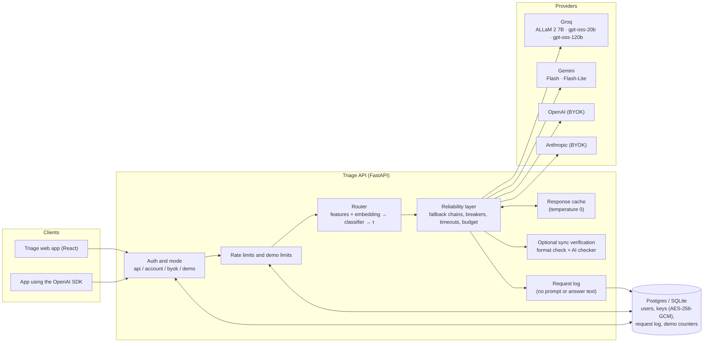
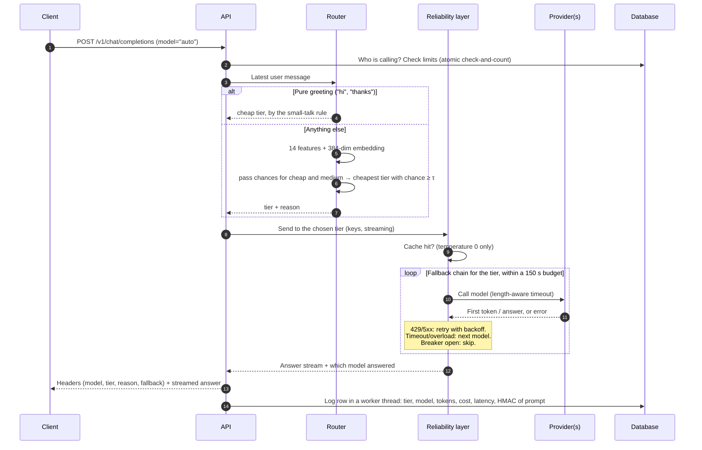
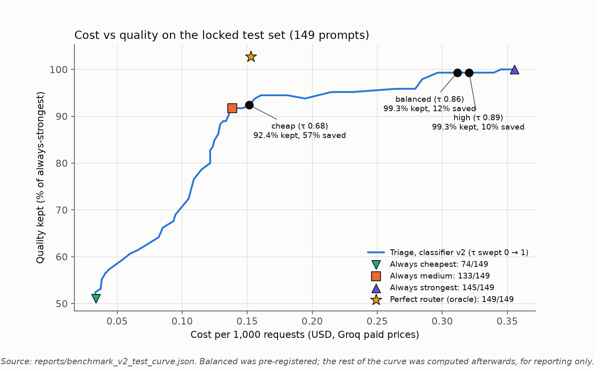
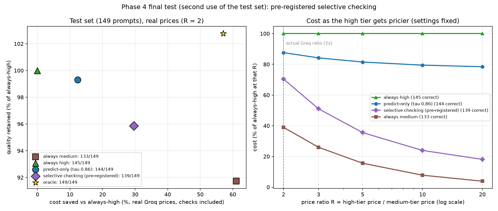
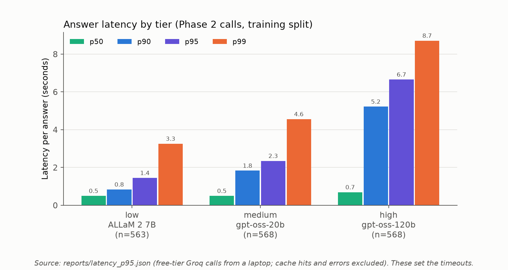
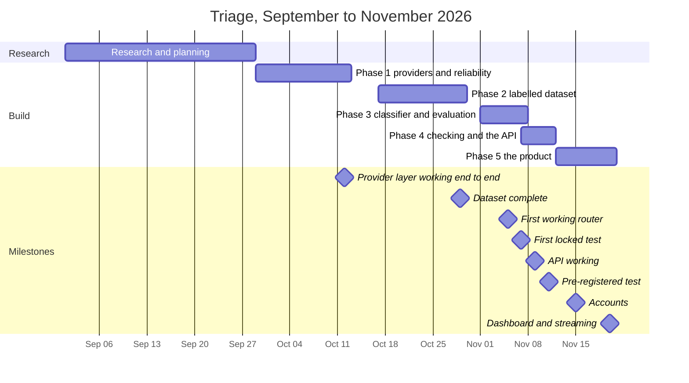

# Triage: a case study

**An OpenAI-compatible LLM router that sends each request to the cheapest model likely to answer it well, and the honest story of how well that works.**

Every number here comes from the project's own measurements and reports, listed under [Sources](#15-sources) at the end. Where something was never measured, the text says so.

---

## Contents

1. [At a glance](#1-at-a-glance)
2. [The problem](#2-the-problem)
3. [What Triage is](#3-what-triage-is)
4. [Architecture](#4-architecture)
5. [The routing model](#5-the-routing-model)
6. [Evaluation](#6-evaluation)
7. [Reliability engineering](#7-reliability-engineering)
8. [The product](#8-the-product)
9. [Security and privacy](#9-security-and-privacy)
10. [Notable bugs found and fixed](#10-notable-bugs-found-and-fixed)
11. [Key decisions and trade-offs](#11-key-decisions-and-trade-offs)
12. [Limitations and what's next](#12-limitations-and-whats-next)
13. [Tech stack and testing](#13-tech-stack-and-testing)
14. [Timeline](#14-timeline)
15. [Sources](#15-sources)

---

## 1. At a glance

Triage sits between an app and its LLM providers. For every request it predicts how likely a cheap, a medium and a strong model are to answer correctly, then picks the cheapest one that clears a quality bar the developer sets. I built the whole thing: a labelled dataset of 762 prompts answered by three models, a classifier, a pre-registered evaluation on a locked test set, a production-ready API with fallbacks and circuit breakers, accounts with encrypted provider keys, and a React web app with chat and a dashboard.

On the held-out test set, the default setting kept **99.3% of the strongest model's quality** (144 of 149 correct against 145) at **12.4% lower cost**, and the cheap preset cut cost by **57.4%** while keeping **92.4%** of the quality. The most useful finding is where the remaining headroom sits: a perfect router, using the same models and the same routing system, would keep full quality at **57% lower cost**. The gap between Triage and that ceiling is in prediction, not in the routing system, so a better classifier converts directly into savings.

| Headline | Value |
|---|---|
| Labelled dataset | 762 prompts, 747 labelled, every prompt answered by all 3 tiers |
| Default (balanced) on the locked test set | 144/149 correct (always-strongest: 145), **12.4% cheaper** |
| Cheap preset on the test set | 92.4% of strong quality kept, **57.4% cheaper** |
| Perfect-router ceiling | 149/149 correct at 57.0% cheaper |
| Classifier quality | ROC AUC 0.67 (cheap) / 0.67 (medium), 5-fold cross-validation |
| AI answer checker on test | caught 4 of the 12 bad answers it saw, so it stays opt-in |
| Router overhead | 2.2–3.6 ms per request |
| Automated tests | 2,319 Python tests passing, plus 30 opt-in Postgres tests and 5 web tests |

> **Highlights**
>
> - **Built end to end:** a 762-prompt labelled dataset, the routing classifier, a pre-registered evaluation, an OpenAI-compatible API with fallbacks and per-model circuit breakers, accounts, and a React web app.
> - **Key result:** the default kept 99.3% of the strongest model's quality at 12.4% lower cost, and a perfect router shows that 57% savings are reachable with better prediction.
> - **Most interesting bug:** Gemini timeouts were retried three times on the same slow model, because Google reports *our own* timeout back as a 504 server error. Lesson: an error's meaning matters more than its status code ([section 10](#10-notable-bugs-found-and-fixed)).
> - **A pre-registered test that disproved my own idea:** an AI answer checker looked promising on validation, but on the locked test set it caught 4 of 12 bad answers and did no better than random routing (139 vs 139.2 correct), so it shipped as opt-in, not the default.
> - **Security by design:** provider keys encrypted with AES-256-GCM and bound to their user, argon2id passwords, HMAC-hashed API keys, and no prompt or answer text ever stored ([section 9](#9-security-and-privacy)).

---

## 2. The problem

Teams using LLMs usually pick one model and send it everything. If they pick a strong model, they overpay for the many requests a small model would have handled ("What is 2 + 3?" does not need a frontier model). If they pick a cheap model, quality drops on the requests that needed more.

The gap is large. On Triage's own data, the cheapest model answered 44.6% of prompts correctly, the medium model 87.3% and the strongest 97.2%. At Groq's paid prices, always using the cheapest model costs about a tenth of always using the strongest: $0.034 vs $0.356 per 1,000 test requests.

The ideal is to send each request to the cheapest model that will still get it right. A perfect router on the test set would have answered **every** prompt correctly while spending 57% less than always using the strongest model, because the cheapest model sometimes gets right what the strongest gets wrong. The hard part is knowing *in advance*, from the prompt alone, which model that is.

Intuition is a poor guide. When 50 prompts were labelled by hand before any answers were seen, the guessed tier matched the real outcome only 17 times (34%). Routing needs to be learned from data.

---

## 3. What Triage is

Triage is an **OpenAI-compatible API**. Any app that already uses the OpenAI SDK switches to it by changing two lines, the base URL and the key, and asking for `model="auto"`:

```python
from openai import OpenAI

client = OpenAI(base_url="https://<your-triage-server>/v1", api_key="trk_...")
reply = client.chat.completions.create(model="auto", messages=[{"role": "user", "content": "What is 2 + 3?"}])
```

For each request, Triage:

- predicts the chance that the cheap and the medium model will pass;
- picks the cheapest tier whose chance clears the **quality dial** (τ), which the caller can set per request with `X-Triage-Quality: cheap | balanced | high | 0–1`;
- calls that model, falling back to backups on other providers if it fails;
- reports what it did in response headers (`X-Triage-Model`, `X-Triage-Tier`, `X-Triage-Reason`, `X-Triage-Cost`, `X-Triage-Saved`, ...) and a `triage` object in the body.

**Who it's for:** developers who call several LLM providers and want lower bills without hand-writing routing rules. Users bring their own provider keys (OpenAI, Anthropic, Groq, Gemini) and pay their providers directly. A free demo runs on the server's own Groq and Gemini keys so anyone can try it without signing up.

Named models work too: asking for a specific model calls exactly that model, with retries but no routing, and Triage claims no savings for it.

---

## 4. Architecture

### Components

| Component | What it does |
|---|---|
| API server (FastAPI) | The OpenAI-compatible `/v1/chat/completions` endpoint (streaming and not), plus model listing, usage statistics, accounts and demo status |
| Router | Handcrafted features + sentence embedding → logistic-regression classifiers → quality dial; a shortcut for small talk |
| Provider adapters | One way to call Groq, Gemini, OpenAI, Anthropic, OpenRouter and Ollama, with every provider error translated into one shared set of error types |
| Reliability layer | Fallback chains, retries with jittered backoff, per-model circuit breakers, length-aware timeouts, a per-request time budget |
| Response cache | Exact-match cache for temperature-0 requests, 24-hour expiry |
| Verifier | Format checks, the AI answer checker, and the LLM judge used for labels |
| Accounts | Users, sessions, password reset, encrypted provider keys, Triage API keys, rate limits, email (Resend) |
| Database | SQLAlchemy Core with 10 versioned migrations. SQLite locally and in tests, Postgres in production (Neon planned; deployment in progress) |
| Web app (React, Vite, Tailwind, shadcn/ui) | Landing page, chat with routing explanations, settings, dashboard, privacy page |
| Evaluation pipeline | Dataset building, scoring, judging, training, simulation, pre-registered tests |



### The life of one request



Step by step:

1. **Identify the caller.** A Triage API key (`trk_...`), a server key, provider-key headers (BYOK) or nothing (demo). The mode is sent back as `X-Triage-Mode`. An `Authorization` header that is sent but invalid is always a 401.
2. **Check limits.** Demo, account and sign-in limits are check-and-count operations that are atomic across server instances: SQLite runs each one in an immediate-write transaction, Postgres under a transaction-level advisory lock.
3. **Decide the tier.** A greeting goes straight to the cheapest tier. Anything else is turned into features and an embedding, and the classifier returns two probabilities. The router then picks the cheapest tier whose probability is at least τ.
4. **Call the model.** The reliability layer walks the tier's fallback chain. It returns as soon as the first token exists, so fallback can only happen before any text reaches the client.
5. **Stream the answer.** Headers go out with the first token, so the model and tier are real. Cost isn't known yet, so it travels in the final stream chunk.
6. **Log it.** One database row and one structured log line, written in a worker thread so a Postgres round trip never blocks the server. No prompt or answer text is stored.

---

## 5. The routing model

### Dataset: labels from outcomes, not opinions

Instead of asking anyone how hard a prompt is, every prompt was **answered by every tier** and labelled with the cheapest tier whose answer actually passed.

| Source | Prompts | Task types | How answers were graded |
|---|---|---|---|
| Hand-written app-style prompts | 162 | extraction, classification, summarization, qa, reasoning, creative | exact match, label match, JSON field check, LLM judge |
| GSM8K (test split) | 200 | reasoning | final number |
| MMLU (test split, all 57 subjects) | 200 | qa | final letter |
| Chatbot Arena (real user prompts, hand-reviewed) | 200 | qa, coding, open-ended, creative, ... | LLM judge |

The three tiers were fixed models on Groq's free tier, with no fallback during collection, so each label describes one specific model:

| Tier | Model | Paid price used for cost (per 1M tokens, in / out) |
|---|---|---|
| low | ALLaM 2 7B | $0.05 / $0.08 (estimate: Groq lists ALLaM as "pending", so this borrows Llama 3.1 8B's last price) |
| medium | gpt-oss-20b, reasoning effort low | $0.075 / $0.30 |
| high | gpt-oss-120b, reasoning effort low | $0.15 / $0.60 |

All calls ran on free tiers; costs are what the same traffic would cost on paid plans.

**Grading.** Ground truth was used wherever it existed: 506 labels come from automatic scorers. The other 241 come from an LLM judge (gpt-oss-120b) that rates an answer 1–5 against the strong model's answer and passes it at 4 or above. Countable constraints ("under 50 words") are counted in code, not by the judge, which turned 8 judge passes into fails. The judge went through three versions and was then frozen.

**Labels.** 747 of 762 prompts are labelled: **333 low (45%), 329 medium (44%), 85 high (11%)**. Fourteen had no usable reference answer and one exceeded a free-tier request limit; every exclusion was written down with its reason.

**Splits.** One stratified 80/20 split (by source and task type, seed 42): 598 labelled train and 149 labelled test prompts. The test prompts are locked by a hash: the data loader refuses to run if they change, and training code checks that no test prompt slipped in. In Phase 4 the training set was split again into 481 fit and 117 validation prompts for tuning.

**What the data showed.** The cheap model's failures are often about *form*: 12 of its 17 extraction failures broke the requested format, and 51 of its 157 GSM8K/MMLU failures left out the `Answer:` line. It also answered 22 prompts mostly in Arabic, a side effect of its bilingual training.

### Features and embeddings

- **14 handcrafted features:** token count and its log, reasoning words ("prove", "compare", "step by step"), constraint count ("must", "at most", "under 50"), whether the prompt includes material to work on, output-format strictness (JSON/code > table > list), and a one-hot task type (8 types).
- **A 384-number sentence embedding** from the open MiniLM sentence model; long prompts are split into chunks and averaged.
- **Task type** comes from the caller (`X-Triage-Task`) or a keyword guesser, which agrees with hand tags 68–72% of the time.

### Classifiers compared

One binary classifier per lower tier answers "will this tier pass?". All were compared with 5-fold cross-validation on the 598 training prompts:

| Classifier | Cheap AUC | Medium AUC | Cheap Brier | Medium Brier |
|---|---|---|---|---|
| Task type only (baseline) | 0.581 | 0.613 | 0.233 | 0.112 |
| A: handcrafted features, tuned | 0.643 | 0.620 | 0.229 | 0.112 |
| B: embeddings, fixed C = 1.0 | 0.569 | 0.612 | 0.389 | 0.167 |
| B: embeddings, tuned | 0.660 | 0.660 | 0.227 | 0.111 |
| **C: both, tuned logistic regression** | **0.672** | **0.667** | **0.224** | **0.111** |
| C: both, gradient boosting | 0.627 | 0.659 | 0.251 | 0.122 |


*ROC AUC for each classifier, 5-fold cross-validation on 598 training prompts.*

**Why C.** Untuned embeddings overfit badly (384 dimensions, about 600 examples): a Brier score of 0.389 is worse than always predicting 50%. Cross-validated regularisation fixed it. Gradient boosting did worse than plain logistic regression at this data size. B and C tied on the training cost/quality curve, and C was kept because its handcrafted features make decisions easier to explain. The strongest handcrafted signal is the number of constraints: more rules make the cheap model more likely to fail.

**Version 2.** In Phase 4 the same model was retrained on the 481-prompt fit set so the 117 validation prompts stayed unseen (cross-validated AUC 0.632 cheap, 0.691 medium). A version trained on *guessed* task types tied it on validation, so hand tags stayed. Version 2 is the model the router serves.

**Training/serving skew was ruled out.** The serving predictor was checked against the training pipeline and matched it exactly, with a maximum difference of 0.0. The predictor also refuses to start if the model file's version, feature version or columns don't match.

### The quality dial (τ) and presets

The rule is simple: **use the cheapest tier whose predicted pass chance is at least τ**; if neither lower tier qualifies, use the strong one. The medium probability is raised to at least the cheap one, since medium is the stronger model.

| Preset | τ | How it was chosen (on training data, classifier v1) |
|---|---|---|
| cheap | 0.68 | best quality at always-medium's cost or less |
| balanced (default) | 0.86 | cheapest τ keeping 95% of strong quality |
| high | 0.89 | cheapest τ keeping 98% of strong quality |

**Caveat:** these presets were chosen for classifier v1 and have not been re-tuned for v2, which is the current model. The routing configuration says so, and it is an early item under [What's next](#12-limitations-and-whats-next).

Every response explains its decision in words, for example `X-Triage-Reason: cheap 0.400 < tau 0.860; medium 0.950 >= tau`. Probabilities are rounded *away* from τ, so the printed inequality is always true.

### The small-talk rule

A message that is only a greeting or pleasantry ("hi", "Thanks!", "Good morning 👋") goes to the cheapest tier without asking the classifier. The **whole** latest message must match a configured phrase after trimming, lowercasing and removing trailing punctuation and emoji, so "hi, can you help with X" is routed normally. These requests are marked as small talk, never used for training, and left out of the savings statistics so they can't inflate them.

---

## 6. Evaluation

### Methodology

- **Replay, not re-run.** Because every prompt has a recorded answer, pass/fail, cost and latency for every tier, any routing strategy can be scored exactly and for free by replaying what the chosen tier did.
- **Baselines.** Always cheapest, always medium, always strongest, random routing at the same tier mix, and a perfect router (oracle) that always knows the cheapest passing tier.
- **"Quality kept"** is the pass rate relative to always-strongest. It can exceed 100% because a cheaper model sometimes passes where the strong one fails.
- **Tuning on validation only.** All choices in Phase 4 were made on the 117 validation prompts.
- **A locked test set, used sparingly.** The 149 test prompts were used once in Phase 3 and once in Phase 4, and each use is recorded so it can't happen silently. The second use is a known weakness: the Phase 3 result was known when Phase 4 began, although nothing in Phase 4 was tuned on the test set.
- **Pre-registration.** Before the Phase 4 test run, a pre-registration file fixed the strategy, the checker model and a hash of its prompt, the classifier, and the exact 100 test prompts to be checked. The scoring step verified all of these still matched before computing anything.

### Headline results (locked test set, 149 prompts, classifier v2)

| Strategy | Correct | Quality kept | Cost saved | Cost per 1k requests |
|---|---|---|---|---|
| Always cheapest | 74 | 51.0% | 90.6% | $0.034 |
| Always medium | 133 | 91.7% | 61.0% | $0.139 |
| Always strongest | 145 | 100.0% | 0% | $0.356 |
| Perfect router (oracle) | 149 | 102.8% | 57.0% | $0.153 |
| **Triage cheap (τ 0.68)** | 134 | 92.4% | 57.4% | $0.152 |
| **Triage balanced (τ 0.86, default, pre-registered)** | **144** | **99.3%** | **12.4%** | $0.311 |
| **Triage high (τ 0.89)** | 144 | 99.3% | 9.8% | $0.321 |

Only balanced was pre-registered; cheap, high and the full curve below were computed after the test, for reporting only, and were not used for tuning.

### The full curve



*Sweeping τ from 0 to 1 traces Triage's cost/quality curve; the oracle sits far above it.*


*Share of test prompts sent to each tier: no preset uses the cheap tier, while the oracle sends half the prompts there.*

**How to read this honestly:**

- **The dial works as designed.** Turning τ up buys quality with money in a smooth, predictable way.
- **Triage does not beat always-medium.** At always-medium's cost, the curve sits at or slightly below it. The cheap preset spends a little more than always-medium for one extra correct answer.
- **The cheap tier is effectively unused at the presets.** The classifier is rarely confident enough that ALLaM 2 7B will pass, and ALLaM passes only about half of the test prompts (74/149), so there is little safe room there.
- **The gap to the oracle is a prediction problem.** Feeding the simulator perfect probabilities reproduces the oracle exactly. The most valuable decision is spotting the roughly 1 in 10 prompts that medium fails, and the medium classifier ranks prompts only modestly better than chance (AUC 0.67).
- **In Phase 3 (classifier v1)** the same test set gave balanced 99.3% kept / 16% saved and cheap 93.1% / 57%; Triage beat random routing at the same tier mix by about 3 quality points on average across the curve.


*The Phase 3 curve (classifier v1) against random routing at the same mix; it tracks random below always-medium's cost and runs slightly above it beyond.*

### Can checking answers beat prediction? (Phase 4)

Phase 4 tested an alternative: answer with the medium model, have an AI checker judge the answer, and escalate to the strong model only when the check fails. To save money, the check is skipped when the classifier is already confident (predicted medium pass chance of at least 0.90).

**On validation it looked promising:** selective checking matched always-strongest (113/117) while saving 27.9%, roughly tied with predict-only (113/117, 28.4% saved).

**The pre-registered test run did not confirm it:**

| Strategy (test, real Groq prices) | Correct | Quality kept | Cost saved | Escalated | Checked |
|---|---|---|---|---|---|
| Always medium | 133 | 91.7% | 61.0% | 0% | 0% |
| Always strongest | 145 | 100.0% | 0% | 100% | 0% |
| Predict-only balanced | 144 | 99.3% | 12.4% | 55% routed to high | 0% |
| Selective checking (pre-registered) | 139 | 95.9% | 29.6% | 6.7% | 67.1% |
| Oracle | 149 | 102.8% | 57.0% | 9.4% | – |

- Medium was wrong on 16 test prompts. The format check caught 2, 2 were skipped as "confident", and of the 12 the AI checker saw it **caught 4 and missed 8**, with 4 false alarms on good answers.
- Random routing at the same cost would get about 139.2 right; selective checking got 139. **The checker added no measurable value**, so predict-only routing stays the default and checking is opt-in (`X-Triage-Verify: sync`).



*Left: test-set quality vs savings at Groq's prices. Right: cost as the strong tier gets pricier, with settings fixed.*

**Why it didn't pay off:** medium is already right about 90% of the time, so most checks confirm a good answer; a check costs about three quarters of a medium answer; Groq's strong model costs only 2× the medium one, so escalating directly is cheap; and the checker (gpt-oss-20b) is the same model as the medium tier, checking its own kind of answer.

### Answer-checker calibration

Before choosing a checker, both candidate models were measured on 241 medium answers from the fit set:

| Checker | Catch rate (95% CI) | False-alarm rate | Trust rate (95% CI) | Flips on repeat runs |
|---|---|---|---|---|
| gpt-oss-20b | 52% (40–64%) | 3.2% | 75% (60–91%) | 2 of 20 |
| gpt-oss-120b | 56% (43–67%) | 4.5% | 69% (53–87%) | 3 of 20 |


*Both checkers miss about half of the bad medium answers; the intervals overlap almost completely.*

gpt-oss-20b was chosen: on open-ended prompts, where the checker would actually run, it caught 23 of 36 bad answers against 19 for gpt-oss-120b, it had fewer false alarms overall, flipped less, and costs half as much.

### How far to trust the labels: judge calibration

The LLM judge that labelled 241 prompts was re-run, unchanged, on 150 GSM8K and MMLU answers whose truth is known.


*The judge agrees with known truth 70% of the time; its errors have two specific causes.*

- **Too strict, in a narrow way.** All 36 correct answers it failed were cheap-tier answers capped for breaking one literal format rule (text after the `Answer:` line).
- **Too lenient only when the reference was wrong.** All 9 wrong answers it passed came from the 14 cases where the strong model's reference answer was itself wrong. With a correct reference, it never passed a wrong answer (0 lenient errors among those 136 answers).
- **Consequence:** judge-graded labels may push some prompts from low to medium over a format slip. The 506 auto-graded labels don't depend on the judge at all.

### Price sensitivity

Groq's strong model costs 2× its medium one. Checking should pay off when escalation is expensive, so the strong tier's price was scaled on validation. Cost to reach 113/117 correct, as a percentage of always-strongest at that ratio:

| Price ratio R (validation) | 2 | 3 | 5 | 10 | 20 | 30 |
|---|---|---|---|---|---|---|
| Predict-only (best τ) | 71.6% | 65.8% | 61.2% | 57.7% | 56.0% | 55.4% |
| Selective checking | 72.1% | 53.8% | 39.1% | 28.1% | 22.7% | 20.8% |


*On validation, checking becomes clearly cheaper once the strong model costs more than about 2–2.5× the medium one.*

On the test set, with settings fixed, selective checking was cheaper than predict-only at every ratio tested, but always 5 correct answers behind, so it never reached predict-only's quality there. Whether checking pays with real multi-provider price gaps (e.g. a small OpenAI model vs a frontier Anthropic model) is **not measured**.

### Latency



*Per-answer latency of each tier on the training split; the strong model's tail is the slowest.*

| Strategy (test set) | p50 latency | p95 latency |
|---|---|---|
| Always medium | 470 ms | 2,314 ms |
| Always strongest | 665 ms | 5,740 ms |
| Predict-only balanced | 516 ms | 5,740 ms |
| Selective checking | 776 ms | 3,757 ms |
| Oracle | 472 ms | 3,399 ms |

These are free-tier calls made from a laptop, so they compare tiers rather than predict production speed. The local Ollama backup (llama3.2:3b) was far slower, with p95 30.8 s. Routing itself adds 2.2–3.6 ms per request. Production latency is **not measured**.

---

## 7. Reliability engineering

LLM providers fail in many ways: rate limits, 5xx errors, "high demand" overloads, slow responses, deadline errors, revoked keys. Phase 1 and much of Phase 5 went into making Triage behave predictably through all of them.

**One error vocabulary.** Every adapter translates every provider error into one of a few kinds: rate limit, server error, overloaded, timeout, connection, client error, auth or configuration. Everything downstream decides by kind, never by provider-specific status codes.

**Retries only where they can help.** Only rate limits (429) and server errors (5xx) are retried: up to 3 tries per model, exponential backoff starting at 0.5 s and capped at 8 s, with full jitter so many failing requests don't retry in lockstep. A bad key or bad request never succeeds on a retry. Timeouts and overloads move **straight to the next model**. The provider SDKs' own retries are switched off, so this layer alone decides.

**Fallback chains.** Each tier has an ordered chain of models. The medium chain, for example, starts with gpt-oss-20b on Groq, then tries Gemini Flash, an OpenAI model, Claude Sonnet and finally Gemini Flash-Lite. The first model is always the one the classifier was trained on. Backups are on different providers, so one outage can't take down a tier. BYOK requests use only the providers the user has keys for.

**Circuit breakers.** Three failures in a row skip a model for 60 seconds; then one trial request is let through. Server errors, timeouts and rate limits trip a breaker for **that model only**; connection and auth errors trip the whole provider. (It used to be provider-wide for everything; see [bugs](#10-notable-bugs-found-and-fixed).) BYOK requests neither read nor write the shared breakers, so one user's bad key can't affect anyone else.

**Timeouts from data, and length-aware.** The default 8 s timeout is the strong model's p95 (6.65 s) rounded up plus 1 s; the strong model itself gets 10 s from its p99 of 8.71 s. Long conversations get more time:

```
timeout = min(base timeout + slope × input tokens / 1,000, cap)
```

For Groq the slope is 0.5 s per 1,000 input tokens, about 3× the 0.1–0.15 s measured, capped at 2× the base. Values for Gemini, OpenAI and Anthropic are marked as guesses to revisit with real traffic.

**A 150-second budget per request.** One request never spends more than 150 s across its whole fallback chain, retries and backoff included. Each call's timeout is cut to the time left, retries stop when a wait wouldn't fit, and the remaining models are logged as skipped because the budget ran out. A stream that has already started is never cut off.

**Overloads and clear errors.** Gemini 503, Anthropic 529, OpenAI 503 and Groq 498 count as overloaded: never retried on the same model. When everything fails, the error says why and names the provider: a 503 for an overloaded provider, a 504 for a timeout, a 503 for a mix of failures, or a 401 when a user's own key was rejected.

**Escalation only to strictly stronger models.** When sync verification rejects an answer, the replacement must come from a model whose own tier is strictly higher. A bad medium answer can't be "fixed" by a low-tier fallback such as Gemini Flash-Lite; if no stronger model answers, the original is served.

**Streaming with Stop and an estimated cost.** Streams use a time-to-first-token limit rather than a total limit: a stream that never starts fails over, and a long answer that streams steadily is never cut off. After the first token there is no fallback; a failure ends the stream with an error event. If the client disconnects (the web chat's Stop button), Triage closes the provider's stream so the model stops generating, logs the request as stopped with a cost estimated from the text sent so far, and never caches the partial answer. Stopped requests count in spend, but not as errors.

**Cache.** Repeated temperature-0 requests are answered from the cache for $0. In the Phase 1 demo, a miss took 486 ms and the identical repeat 0.1 ms. Streamed and plain requests share entries; a streamed answer is cached only if it finished on its own. BYOK cache entries are keyed with an HMAC fingerprint of the user's key, so users never share cached answers. Cache hits never count as the provider being healthy and are never used as training data.

---

## 8. The product

> **Screenshots: coming after deployment.**

Phase 5 turned the research system into a product a stranger can use. (Phase 5 has no written report; this section is drawn from the project documentation, the code and the commit history.)

### Request modes

| Mode | Who | Keys used | Limits |
|---|---|---|---|
| demo | anyone, no sign-up | the server's Groq and Gemini keys | 10 requests per visitor per day; 300 requests, 150,000 tokens and 600 model calls per day for everyone together; 4 a minute overall; 8,000-character prompts; maximum answer length lowered to 2,048 tokens |
| byok | anyone sending their own provider keys in headers | the user's own, only those providers | 200 a day per visitor without a Triage key |
| account | signed-in users or their `trk_` keys | the user's saved, encrypted provider keys | 60 a minute, 10,000 a day per account |
| api | the operator's own server keys | the server's | none |

Demo refusals are 429s with a `Retry-After` header and suggest adding a provider key; a status endpoint lets the website show the remaining allowance before the first message.

### Accounts

- **Sign-up and log-in** with email and password (10–128 characters, hashed with argon2id). Sessions last 30 days, or 7 days unused.
- **Password reset with codes.** A 6-digit code is emailed (expires in 10 minutes, 5 wrong tries kill it), exchanged for a single-use reset token (15 minutes), then the new password logs out every other session. The request step always answers the same 202, and the email is sent after the response, so neither the answer nor its timing reveals which emails have accounts.
- **Emails** through Resend: reset codes and a welcome email with three setup steps. Signup never waits for or fails because of the email. A bad sender address is caught at startup instead of failing every send.
- **Saved provider keys** are checked with one free list-models call when saved, encrypted, and shown only by their last 4 characters. If a provider later rejects a key (401/403), it's marked invalid with the reason and Triage stops using it.
- **Triage API keys** (`trk_...`) are shown once at creation; up to 20 active per account.
- **Preferred provider:** within each tier, that provider's model is tried first; savings are then measured against that provider's own strongest model.

### Web app

- **Landing page:** the problem, how routing works, an interactive quality-dial demo, the real benchmark numbers (exported directly from the evaluation results), the two-line integration, security, and FAQs.
- **Chat:** streamed answers with a Stop button, multiple saved chats (kept only in the browser), and a **routing panel** under each answer that explains in plain language which model answered, why, the predicted pass chances against the bar, the cost, and the saving. Friendly error cards for every API error code. A banner locks the input when the free demo is used up.
- **Settings:** Get started (a setup checklist), Provider keys, API keys (create in a popup, revoke), and Account (profile, password, clear chats, delete account).
- **Dashboard:** *Benchmark* (the test-set headline, curve and tier mix), *Overview* (totals across everyone's routed requests, shown only once a range has 100 of them so no individual is identifiable), and *My usage* (spend, savings, a "Saved %" per API key, paginated recent requests, stopped requests shown apart from failures).
- **Privacy page** rendered from a single document, and a layout that works on phones.

**Not measured:** real users, real traffic volume, or real-world savings. Triage is not deployed yet (deployment in progress), and there is no usage data.

---

## 9. Security and privacy

### What's stored, and how

| Data | How it's stored |
|---|---|
| Passwords | argon2id hash, at OWASP's parameters (19 MiB, t=2, p=1) |
| Session tokens | SHA-256 hash only; the token lives in the browser |
| Triage API keys (`trk_`) | a short public id plus an HMAC-SHA256 keyed with a server secret, compared in constant time |
| Password-reset codes and tokens | keyed hashes only, never the code, token or email |
| Provider keys | **AES-256-GCM**, a fresh random 96-bit nonce per encryption, and associated data binding the ciphertext to the user and provider, so a row copied to another user won't decrypt. Encryption keys are versioned, and a rotation tool re-encrypts every row, refusing to change anything if any row fails to decrypt |
| Demo visitors | IP address only as an HMAC (IPv6 grouped by /64); the `X-Forwarded-For` header is ignored unless the operator sets the number of trusted proxies |
| Request log | tier, model, probabilities, tokens, cost, latency, status, and an **HMAC of the prompt** (not a plain hash, so a guessed prompt can't be tested against it without the secret) |

### What's never stored

Prompt text, answer text, API keys, and provider error messages, in the database, the log lines or any API response. Tests search the raw database files and log lines for keys, prompts and answers. Key-shaped text is redacted from provider errors before logging. A decrypted provider key exists only for the request that uses it: never in a cache, global or background job.

Chat history stays in the user's browser. Demo, BYOK and account requests are **never used for training**; only requests made with the operator's own internal keys are.

The documentation is candid that the request log is still sensitive: the stored embeddings and features aren't text, but similar prompts get similar vectors, so the log is protected like user data.

### Retention

An hourly job deletes cached answers older than 24 hours and request-log rows older than 365 days, along with their labels. Deleting an account removes the user, sessions, saved keys and API keys immediately; request rows stay for statistics with the link to the account removed.

### Rate limits

| What | Limit |
|---|---|
| Sign-up | 5 per IP per hour |
| Log-in | 10 per IP per 15 min; 5 wrong passwords per account per 15 min (answered with the same 401 as a wrong password) |
| Reset codes | 3 per email and 10 per IP per hour; one email per address per 60 s |
| Checking codes | 10 per IP per 15 min; 5 tries per code; 10 wrong codes per email per day |
| Saving provider keys | 20 per account per hour |

### Fact-checking the privacy policy against the code

The privacy policy was written as a draft first and then checked claim by claim against the code before publishing. The check found statements that were false or incomplete, and the published text corrected them: demo prompts are not stored or used for training; answers *are* cached for up to 24 hours; request records are kept 12 months and *unlinked*, not deleted, when an account is deleted; the visitor hash also drives sign-in rate limits; and hosting-provider logs may contain IPs.

A second pass then made the code live up to the policy:

- The web server's access log prints client IPs, which contradicted "Triage logs no IP". Every documented way of starting the server now turns that log off, and a test checks every start command in the documentation, scripts and deployment configuration.
- A new test confirms that no log line contains the client's IP on the demo, public-stats, sign-up and failed log-in paths behind a proxy.
- A test confirms the stats endpoints keep working after retention deletes the rows they pointed to.

---

## 10. Notable bugs found and fixed

| # | Bug | Root cause | Fix | Lesson |
|---|---|---|---|---|
| 1 | **Gemini timeouts retried three times** | Google enforces *our* per-call timeout (the SDK sends it in a request header) and returns a 504 deadline error. That was classified as a server error, so the same slow model was retried three times. Separately, 30 s was too short for Gemini Flash | Deadline errors are timeouts and move straight to the next model; Gemini gets 60 s and thinks at "low" | An error's *meaning* matters more than its status code |
| 2 | **Timeouts misclassified across every provider** | The same mistake existed elsewhere: 408/504 counted as client/server errors, Anthropic's timeout error and mid-stream read timeouts weren't treated as timeouts | All four adapters now classify timeouts consistently, with tests against a real slow local server | When you find a bug, look for its siblings |
| 3 | **One slow model blocked a whole provider** | The circuit breaker counted timeouts and 5xx per *provider*, so a slow gpt-oss-120b skipped every Groq model for 60 s and sent escalations to a weaker backup | Breakers are per model; only connection and auth errors are provider-wide | Scope failure tracking to what actually failed |
| 4 | **Overloads retried on the same model** | Gemini's "high demand" 503 was retried, and Google's SDK had its own retries on | A new "overloaded" error kind, never retried; SDK retries switched off in every adapter | Two retry layers multiply; keep exactly one |
| 5 | **Escalation could swap in a weaker model** | Verification escalated along the fallback chain, which ends with a low-tier last resort | Escalation only to a model whose own tier is strictly higher | Fallback for availability and escalation for quality need different rules |
| 6 | **Stopped streams kept generating** | When the client disconnected, the provider's stream wasn't closed, so the model kept generating until garbage collection | Close the stream all the way down to the HTTP connection; log the request once as stopped with an estimated cost | "Stop" has to reach all the way to the provider |
| 7 | **Saving a provider key failed in the browser** | The CORS preflight didn't allow `PUT` | Allowed methods kept in one list, plus a test that preflights every method of every route | Test the browser path, not only the API path |
| 8 | **Savings credited to named-model requests** | A request for an explicit model was counted as a Triage saving, though the caller chose it | No saving for named models; stats recompute savings in SQL so old rows count correctly too | Only claim credit for decisions the system made |
| 9 | **The cheap model replied in Arabic** | ALLaM 2 7B is bilingual and sometimes answered short English messages like "hello" in Arabic. Phase 2 had already seen 22 mostly-Arabic answers | A per-model system prefix: "Always reply in the same language as the user's latest message." It is the one documented exception to "serving settings = training settings" | Model quirks surface first in the data; read the answers |
| 10 | **A fake answer served in real mode** | Test runs with fake models wrote into the real response cache | Fake mode has its own cache and database, and each mode refuses the other's files; the poisoned entry was removed | Test modes must be physically isolated, not just flagged |
| 11 | **A JSON-mode rejection retried forever** | Groq's JSON-validation 400 was treated as a provider error | Recorded as a finished "invalid JSON" verdict | Some errors are answers |
| 12 | **Browser saw a network error instead of a 500** | The web framework sends its 500 from outside every middleware, without CORS headers | A small middleware inside CORS returns an OpenAI-style 500 that never includes exception text | Error paths need the same headers as success paths |
| 13 | **Every reset email failed** | A stray quote in the sender address (kept by some environment-file loaders) made Resend reject each send with 422 | Clean and validate the sender at startup; one warning naming the setting, never its value | Validate configuration at startup, not on first use |
| 14 | **Untuned embeddings overfit** | 384 dimensions and about 600 examples with C = 1.0 gave a Brier score of 0.389, worse than a coin flip | Cross-validated regularisation (C ≈ 0.003) | Small data needs strong regularisation; always compare with a trivial baseline |

---

## 11. Key decisions and trade-offs

| Decision | Alternatives | Why | Trade-off |
|---|---|---|---|
| Label prompts by **outcome** (cheapest tier that passed) | Human difficulty ratings | Hand guesses matched outcomes only 34% of the time | 3× the collection cost; labels tied to three specific models |
| **All three tiers on Groq** | Mix providers | Free limits large enough to collect everything | Price gap only 2×, which limits savings; a Groq outage sends traffic to backups the classifier never saw |
| **Logistic regression** on features + embeddings | Gradient boosting, embeddings only | Best AUC and Brier at ~600 examples; explainable | Modest ceiling (AUC 0.67) |
| A **quality dial** with three presets | One fixed threshold | Different apps value cost and quality differently | Presets still tuned for v1 |
| **Pre-register** the final test | Report the best validation result | Validation results flattered the checker; the test didn't confirm it | Publishing a weak result |
| **Predict-only** routing as default; checking opt-in | Check every medium answer | Checking matched random routing on test | Gives up savings that might exist with larger price gaps |
| Retry only 429/5xx; **timeouts and overloads fall back** immediately | Retry everything | A slow or overloaded model rarely recovers within seconds | A transient blip costs a fallback to a pricier backup |
| **Per-model** circuit breakers | Per-provider | Groq rate-limits and fails per model | More state to track |
| **No fallback after the first streamed token** | Restart on another model mid-answer | The user would see two different answers spliced together | A mid-stream failure ends with an error |
| Store an **HMAC of the prompt**, never text | Store prompts for debugging and training | Privacy promise, smaller blast radius | Harder to debug; retraining relies on stored features and embeddings |
| **AES-256-GCM** with per-user associated data and versioned keys | Plain storage, or a cloud KMS | Strong, standard, rotatable without downtime | Losing every key that encrypted a row makes that row unreadable (user must re-save) |
| **SQLite locally, Postgres in production** via SQLAlchemy Core | Postgres everywhere | Tests run offline in seconds | Two dialects; concurrency behaviour verified by separate Postgres tests |
| Retrain only if **better on validation** | Retrain on a schedule | A new model can't silently make routing worse | Slower to adapt |
| **Small talk** bypasses the classifier | Let the classifier decide | Greetings don't need a model; saves a prediction | A phrase list to maintain |

---

## 12. Limitations and what's next

### Limitations

- **Savings at the default are modest.** 12.4% on the test set at near-full quality, and no preset clearly beats always using the medium model.
- **The presets haven't been re-tuned for classifier v2.** They were picked for v1.
- **The test set is small.** 149 prompts, and medium was wrong only 16 times on it, so one or two prompts move every conclusion. It has also been used twice.
- **Groq-only benchmark.** All three tiers and the checker are Groq models with a 2× price gap. The OpenAI and Anthropic models in the BYOK chains have no benchmark data; their timeouts and latency slopes are marked as guesses in the configuration.
- **Not deployed yet.** Deployment is in progress, so there are no users and no production measurements.
- **No real traffic yet.** Every result comes from benchmark prompts. Retraining is built and guarded, but no retraining run has happened yet, and only the operator's own API traffic is eligible for training.
- **Label noise.** Each prompt was answered once per tier; 50 medium labels assume a pass; the judge enforces format rules literally and inherits a wrong reference.
- **Thin coverage of developer tasks.** Only 47 coding prompts and no system-design category.
- **Cost estimates.** ALLaM's paid price is still "pending", so its cost borrows another model's price.
- **Operational gaps** listed in the documentation: no email verification at sign-up; per-minute limits are kept in memory per server instance; routing-config changes made through the admin API aren't persisted; keys rejected during a verification escalation aren't marked invalid yet.

### What's next

1. **Deploy and run with real traffic** on the planned hosts (Render, Vercel, Neon).
2. **Re-tune the presets for classifier v2** on the validation set.
3. **Retrain with real usage** once eligible traffic exists, using the replace-only-if-better rule.
4. **A stronger cheap tier.** ALLaM passes only about half the prompts; a better small model leaves more room to save.
5. **Benchmark across providers** (OpenAI, Anthropic, Gemini), where price gaps are much larger than 2× and answer checking might pay.
6. **A better checker:** a different, stronger model than the one that wrote the answer, or task-specific checks.
7. **More data:** coding and open-ended prompts, with two samples per prompt to reduce label noise, and a larger test set.

---

## 13. Tech stack and testing

| Layer | Technology |
|---|---|
| API | Python 3.14, FastAPI, Uvicorn, Pydantic |
| ML | scikit-learn (logistic regression with CV, gradient boosting), sentence-transformers (all-MiniLM-L6-v2), NumPy |
| Providers | official OpenAI, Anthropic and Google Gen AI SDKs; an OpenAI-format adapter for Groq, OpenRouter and Ollama |
| Data | SQLAlchemy Core, Alembic, SQLite, Postgres via psycopg (Neon planned) |
| Security | argon2, AES-GCM from the Python cryptography library, HMAC-SHA256 |
| Web | React 19, TypeScript, Vite, Tailwind CSS 4, shadcn/ui, Recharts, React Router |
| Hosting (planned; deployment in progress) | Render (API), Vercel (website), Neon (database), Resend (email), as named in the privacy policy |
| Charts in this document | matplotlib, regenerated from the evaluation results |

Every dependency is pinned to the version that was installed and tested.

### Testing

| Suite | Result |
|---|---|
| Python unit and integration tests | **2,319 passed**, 30 skipped, across 82 test files (run locally on 2026-11-20 for this write-up) |
| Postgres tests | 30 tests, opt-in, run against a throwaway Postgres with a separate schema per test. **Not run for this write-up**, since they need a test database |
| Web tests | 5 passed (Node's built-in test runner) |

The default suite needs no network: providers are faked, and tests never touch the real database or cache files. Notable kinds of tests:

- adapters against a **real slow local HTTP server**, to check timeouts on the wire;
- a CORS **preflight for every method of every route**;
- searching raw database files and log lines for **leaked keys, prompts and answers**;
- checking that **serving generation settings match the Phase 2 collection settings**, since the classifier predicts for exactly those;
- checking each configured timeout against the measured latencies;
- checking that **no request-log call blocks the server's event loop**;
- **concurrency tests on Postgres** for the demo limiter and account limits.

**CI:** there is no continuous-integration setup yet. Tests are run locally.

---

## 14. Timeline

About two and a half months, from early September to November 20, 2026. Every date after September 28 comes from the git history.



Milestones are marked with ★.

### Research and planning (early September – September 28)

About four weeks of research and planning before the first commit.

<!-- TODO (author): describe what was researched and planned in this period. -->

### Phase 1: providers and reliability (September 29 – October 12)

- **September 29–30.** First commit, and a check that every provider connection works.
- **October 1–11.** No commits.
- **October 12.** One interface for calling every provider, with streaming. A reliability layer with jittered retries, fallback chains and a circuit breaker. An exact-match response cache with expiry. ★ **The provider layer works end to end** (October 12).

### Phase 2: the labelled dataset (October 17 – October 29)

- **October 17–19.** 162 hand-reviewed custom prompts. Loaders for GSM8K, MMLU (one broken row excluded) and Chatbot Arena, 200 prompts each. All 762 prompts merged, and dataset versions pinned for reproducibility. Collection set up with all three tiers on Groq, plus the first scorers and a pilot run.
- **October 20–23.** Automatic scoring. 50 blind hand labels. An LLM judge with a rubric, then a runner to judge every open-ended answer. Outcome labels built, and the 80/20 train/test split locked. A review of reference answers excluded 12 benchmark prompts. The judge learned to count constraints in code and to treat the reference as a quality bar rather than ground truth; version 3 was frozen on October 23.
- **October 28–29.** One prompt excluded for exceeding Groq's request-size limit. Hand labels compared with real outcomes. ★ **Dataset complete** (October 29).

### Phase 3: the classifier and evaluation (November 1 – November 7)

- **November 1–2.** Handcrafted prompt features. A sampler for checking the judge. A re-review of the 11 prompts every tier failed (none excluded).
- **November 3–7.** Prompt embeddings and classifier training, with cross-validated metrics for classifiers A, B and C (November 3). The quality dial (November 4). The predictor connecting features, embeddings, classifier and dial, plus the routing simulator and baselines: ★ **first working router** (November 5). Cascade experiments, judge calibration and ★ **the first locked test** (November 7).

### Phase 4: checking and the API (November 7 – November 11)

- **November 7–8.** A validation split, serving settings matched to the collection settings, timeouts derived from measured latency, and classifier v2. The AI answer checker and verification pipeline, with three versions of the checker prompt, and a calibration sample.
- **November 9–11.** Checker metrics, and the routing simulation for answer checking. ★ **The OpenAI-compatible API works**, with streaming (PR 1, November 9). A request log that stores an HMAC of the prompt instead of the text, plus stored features for retraining (PR 2). Calibration results chose gpt-oss-20b as the checker (November 10). Sync and background verification with per-model circuit breakers (PR 3), safe retraining with the replace-only-if-better rule (PR 4), and selective checking (PRs 5–6). Validation results and the price-gap analysis (November 11). ★ **Pre-registration and the pre-registered test** (November 11): the checker added no measurable value (PRs 7–8). Fake mode isolated from real data (PR 9), and the Phase 4 write-up.

### Phase 5: the product (November 12 – November 20)

- **November 12–15.** Bring-your-own-key access with OpenAI and Anthropic models (PR 10). A public demo with limits, demo status and CORS for the website (PR 11). The React app, chat layout and chat connected to the real API, with a routing panel that explains each decision in plain words and chat history kept in the browser (PRs 12–13). A preferred-provider option (PR 14). A database layer with versioned migrations, the request log and demo counters moved onto it, and Postgres concurrency tests (PRs 15–16). ★ **Accounts** (November 15): sign-up and log-in (PR 17), encrypted provider keys (PR 18), Triage API keys (PR 19), chat with an account's own keys (PR 20), and documentation with every dependency pinned (PR 21). The MIT license and the landing page (PR 22).
- **November 16–19.** Sign-up and log-in pages (PR 23). Password reset by emailed code, with a redesigned email (PR 24, November 16). Settings pages for getting started, API keys, provider keys and the account; a welcome email (PR 25, November 17–19). Reliability hardening on November 19: Gemini deadline errors treated as timeouts, overloads falling back at once, escalation only to stronger models, length-aware timeouts within a 150 s budget, greetings routed without the classifier, and the cheap model told to reply in the user's language (PR 26). An hourly retention job, the privacy page, and the privacy policy published after a check against the code. Statistics endpoints for the dashboard, tested on Postgres.
- **November 20.** ★ **The dashboard**: Benchmark, Overview and My usage tabs (PRs 27–28). The privacy policy's retention and IP promises enforced in code (PR 29). A layout that works on phones (PR 30). ★ **Streaming in the web chat, with Stop**, estimated cost for stopped answers, and streamed answers served from the cache (PR 31). A new footer and FAQs, and this case study.

**In total:** about 2.5 months, 275 commits and 31 pull requests.

---

## 15. Sources

Every number above can be checked against these files in the repository:

- `reports/PHASE_1.md`: Phase 1, the provider layer, reliability and cache.
- `reports/PHASE_2.md`: the dataset, grading, labels, splits and hand-label comparison.
- `reports/PHASE_3.md`: features, classifiers, the quality dial and the first locked test.
- `reports/PHASE_4.md`: answer checking, classifier v2, the pre-registered test and the API.
- `reports/benchmark_v2_test_curve.json`: headline test results and the full cost/quality curve for classifier v2.
- `reports/final_test_phase4.json`: the pre-registered test, latency per strategy and price ratios on the test set.
- `reports/PHASE4_PREREGISTRATION.json`: what was fixed before the pre-registered test.
- `reports/pareto_test.json`: the Phase 3 curve, the random-routing comparison and router overhead.
- `reports/checker_calibration.json`: answer-checker calibration.
- `reports/judge_calibration.json`: judge calibration against known answers.
- `reports/price_sensitivity_val.json`: price-ratio sensitivity on validation.
- `reports/latency_p95.json`: per-tier latency and timeout data.
- `models/classifier_*_v1.json` and `models/classifier_*_v2.json`: cross-validated classifier metrics.
- `scripts/case_study_figures.py`: regenerates every chart in `docs/case-study/` from the files above.

Test counts come from running the test suites on 2026-11-20, not from a file. The timeline comes from `git log`.
