# Triage

**Every LLM request, sent to the cheapest model that can answer it well.**

*A case study: an OpenAI-compatible LLM router that predicts which model each request needs, and the honest story of how well that works.*

Every number in this case study comes from the project's own measurements. Where something hasn't been measured yet, the text says so.

---

## Contents

1. [At a glance](#1-at-a-glance)
2. [The problem](#2-the-problem)
3. [What Triage is](#3-what-triage-is)
4. [Architecture](#4-architecture)
5. [The routing model](#5-the-routing-model)
6. [Evaluation](#6-evaluation)
7. [Reliability](#7-reliability)
8. [The product](#8-the-product)
9. [Security and privacy](#9-security-and-privacy)
10. [Lessons from building it](#10-lessons-from-building-it)
11. [Key decisions and trade-offs](#11-key-decisions-and-trade-offs)
12. [Limitations and future work](#12-limitations-and-future-work)
13. [Tech stack and testing](#13-tech-stack-and-testing)
14. [Timeline](#14-timeline)

---

## 1. At a glance

Triage sits between an app and its LLM providers. For every request, it predicts how likely a cheap, a medium and a strong model are to answer correctly, then picks the cheapest one that clears a quality bar the developer sets. I built it end to end: a labelled dataset of 762 prompts answered by three models, a routing classifier, a pre-registered evaluation on a locked test set, a production-ready API with automatic fallbacks, accounts with encrypted provider keys, and a web app with chat and a dashboard.

On the held-out test set, the default setting kept **99.3% of the strongest model's quality** (144 of 149 correct, against 145) at **12.4% lower cost**, and the cheap preset cut cost by **57.4%** while keeping **92.4%** of the quality. The most useful finding is where the remaining headroom sits: a perfect router, using the same models, would keep full quality at **57% lower cost**. The gap between Triage and that ceiling is in prediction, not in the routing system, so a better classifier converts directly into savings.

| Headline | Value |
|---|---|
| Labelled dataset | 762 prompts, 747 labelled, every prompt answered by all 3 tiers |
| Default setting on the locked test set | 144/149 correct (always-strongest: 145), **12.4% cheaper** |
| Cheap setting on the test set | 92.4% of strong quality kept, **57.4% cheaper** |
| Perfect-router ceiling | 149/149 correct at 57% cheaper |
| Classifier quality | ROC AUC 0.67 (cheap) / 0.67 (medium), 5-fold cross-validation |
| AI answer checker on the test set | caught 4 of 12 bad answers, so it stays opt-in |
| Routing overhead | 2.2–3.6 ms per request |
| Automated tests | 2,319 Python tests passing, plus Postgres and web tests |

> **Highlights**
>
> - **Built end to end:** a labelled dataset, the routing classifier, a pre-registered evaluation, an OpenAI-compatible API with automatic fallbacks, accounts, and a web app with chat and a dashboard.
> - **Key result:** the default kept 99.3% of the strongest model's quality at 12.4% lower cost, and a perfect router shows that 57% savings are reachable with better prediction.
> - **A pre-registered test that disproved my own idea:** an AI answer checker looked promising on validation, but on the locked test set it did no better than random routing, so it shipped as opt-in rather than the default.
> - **Most interesting lesson:** a provider's "too slow" error looked like a server failure, so Triage kept retrying the same slow model. Understanding what an error *means* mattered more than its status code ([section 10](#10-lessons-from-building-it)).
> - **Privacy by design:** provider keys are encrypted, passwords and API keys are never stored in readable form, and no prompt or answer text is ever stored ([section 9](#9-security-and-privacy)).

---

## 2. The problem

Teams using LLMs usually pick one model and send it everything. If they pick a strong model, they overpay for the many requests a small model could handle ("What is 2 + 3?" doesn't need a frontier model). If they pick a cheap model, quality drops on the requests that needed more.

The gap is large. On Triage's own data, the cheapest model answered 44.6% of prompts correctly, the medium model 87.3% and the strongest 97.2%. At Groq's paid prices, always using the cheapest model costs about a tenth of always using the strongest: $0.034 vs $0.356 per 1,000 test requests.

The ideal is to send each request to the cheapest model that will still get it right. A perfect router on the test set would have answered **every** prompt correctly while spending 57% less than always using the strongest model, because the cheapest model sometimes gets right what the strongest gets wrong. The hard part is knowing *in advance*, from the prompt alone, which model that is.

Intuition is a poor guide. When 50 prompts were labelled by hand before any answers were seen, the guessed tier matched the real outcome only 17 times (34%). Routing has to be learned from data.

---

## 3. What Triage is

Triage is an **OpenAI-compatible API**. Any app that already uses the OpenAI SDK switches to it by changing two lines, the base URL and the key, and asking for `model="auto"`:

```python
from openai import OpenAI

client = OpenAI(base_url="https://<your-triage-server>/v1", api_key="trk_...")
reply = client.chat.completions.create(model="auto", messages=[{"role": "user", "content": "What is 2 + 3?"}])
```

For each request, Triage:

- predicts the chance that the cheap and the medium model will answer well;
- picks the cheapest model whose chance clears the **quality dial**, which the caller can set per request (`X-Triage-Quality: cheap | balanced | high`);
- calls that model, falling back to backups on other providers if it fails;
- reports what it did in response headers (`X-Triage-Model`, `X-Triage-Tier`, `X-Triage-Reason`, `X-Triage-Cost`, `X-Triage-Saved`, ...).

**Who it's for:** developers who call LLM providers and want lower bills without hand-writing routing rules. Users bring their own provider keys (OpenAI, Anthropic, Groq, Gemini) and pay their providers directly. A free demo lets anyone try it without signing up.

Asking for a specific model also works: Triage calls exactly that model, with automatic retries but no routing, and claims no savings for it.

---

## 4. Architecture

### Components

| Component | What it does |
|---|---|
| API server | The OpenAI-compatible chat endpoint (streaming and not), plus usage statistics, accounts and demo status |
| Router | Turns a prompt into features and a sentence embedding, predicts pass chances, and applies the quality dial |
| Provider layer | One consistent way to call Groq, Gemini, OpenAI and Anthropic, with every provider's errors translated into one shared vocabulary |
| Reliability layer | Fallback chains, targeted retries, circuit breakers, timeouts and a per-request time budget |
| Response cache | Answers identical repeated requests for free, for up to 24 hours |
| Answer checking | Optional format checks and an AI answer checker |
| Accounts | Sign-up and log-in, password reset, encrypted provider keys, Triage API keys, rate limits, email |
| Database | SQLite for local development and tests, Postgres in production (hosted on Neon) |
| Web app | Landing page, chat with routing explanations, settings, dashboard and privacy page |
| Evaluation pipeline | Dataset building, grading, training, simulation and pre-registered tests |

The diagram shows the request path (top) and the offline pipeline that produces the routing model (bottom).

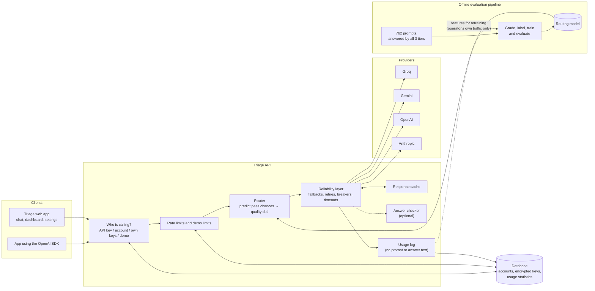

### The life of one request

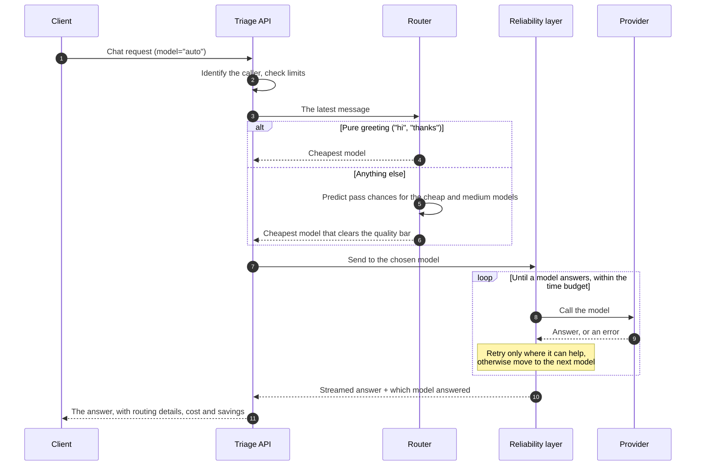

In words:

1. **Identify the caller:** a Triage API key, a signed-in session, the user's own provider keys, or nobody (the free demo).
2. **Check limits:** demo and account limits are counted safely even across several servers.
3. **Decide the model:** a pure greeting goes straight to the cheapest model; anything else gets a prediction, and the cheapest model that clears the quality bar is chosen.
4. **Call the model:** if it fails, the reliability layer moves to a backup, but only before any text has been sent.
5. **Stream the answer:** routing details come with the first words; cost and savings arrive at the end.
6. **Record it:** only routing details, cost and timing are stored, never the prompt or the answer.

---

## 5. The routing model

### Dataset: labels from outcomes, not opinions

Instead of asking anyone how hard a prompt is, every prompt was **answered by every tier** and labelled with the cheapest tier whose answer actually passed.

| Source | Prompts | Task types | How answers were graded |
|---|---|---|---|
| Hand-written app-style prompts | 162 | extraction, classification, summarization, Q&A, reasoning, creative | exact match, label match, JSON field check, LLM judge |
| GSM8K | 200 | reasoning | final number |
| MMLU (all 57 subjects) | 200 | Q&A | final letter |
| Chatbot Arena (real user prompts, hand-reviewed) | 200 | Q&A, coding, open-ended, creative and more | LLM judge |

The three tiers were fixed models on Groq, so each label describes one specific model:

| Tier | Model | Paid price used for cost (per 1M tokens, in / out) |
|---|---|---|
| Cheap | ALLaM 2 7B | $0.05 / $0.08 (an estimate, since Groq lists its price as pending) |
| Medium | gpt-oss-20b | $0.075 / $0.30 |
| Strong | gpt-oss-120b | $0.15 / $0.60 |

All calls ran on free tiers; costs are what the same traffic would cost on paid plans.

**Grading.** Ground truth was used wherever it existed: 506 labels come from automatic scoring. The other 241 come from an LLM judge that rates each answer against the strong model's answer. Countable rules ("under 50 words") are checked exactly rather than by the judge. The judge went through three versions and was then frozen.

**Labels.** 747 of 762 prompts are labelled: **333 cheap (45%), 329 medium (44%), 85 strong (11%)**. The 15 excluded prompts each have a recorded reason.

**Splits.** A stratified 80/20 split: 598 training prompts and 149 test prompts. The test set is locked, so any change to it is detected, and it was never used for training. Later, the training set was split again into 481 fit and 117 validation prompts for tuning.

**What the data showed.** The cheap model's failures are often about *form* rather than knowledge: 12 of its 17 extraction failures broke the requested format, and 51 of its 157 math and multiple-choice failures left out the final answer line. It also answered 22 prompts mostly in Arabic, a side effect of its bilingual training.

### What the classifier sees

- **14 handcrafted features:** prompt length, reasoning words ("prove", "compare", "step by step"), the number of constraints ("must", "at most", "under 50"), whether the prompt includes material to work on, how strict the output format is, and the task type.
- **A sentence embedding** from an open sentence-embedding model, capturing what the prompt is about.
- **The task type**, given by the caller or guessed from keywords.

### Classifiers compared

For each of the two cheaper tiers, a classifier answers "will this tier pass?". All approaches were compared with 5-fold cross-validation on the 598 training prompts:

| Classifier | Cheap AUC | Medium AUC | Cheap Brier | Medium Brier |
|---|---|---|---|---|
| Task type only (baseline) | 0.581 | 0.613 | 0.233 | 0.112 |
| A: handcrafted features | 0.643 | 0.620 | 0.229 | 0.112 |
| B: embeddings, untuned | 0.569 | 0.612 | 0.389 | 0.167 |
| B: embeddings, tuned | 0.660 | 0.660 | 0.227 | 0.111 |
| **C: both, logistic regression** | **0.672** | **0.667** | **0.224** | **0.111** |
| C: both, gradient boosting | 0.627 | 0.659 | 0.251 | 0.122 |

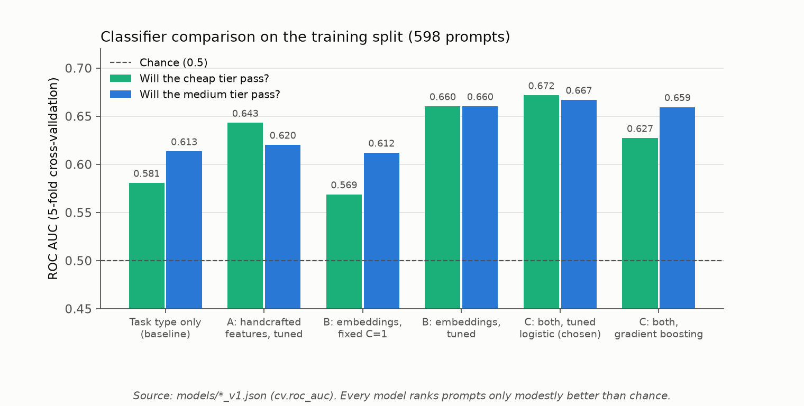

*ROC AUC for each classifier, 5-fold cross-validation on 598 training prompts.*

**Why C.** Untuned embeddings overfit badly with only about 600 examples: their probabilities were worse than always guessing 50%. Proper regularisation fixed that. Gradient boosting did worse than plain logistic regression at this data size. B and C tied on cost and quality, and C was kept because its handcrafted features make decisions easier to explain. The strongest single signal is the number of constraints: more rules make the cheap model more likely to fail.

**Version 2.** The same model was later retrained on the fit set only, so the validation prompts stayed unseen. Version 2 is the model Triage serves. Its predictions were checked to match the training pipeline exactly, so the served model behaves like the evaluated one.

### The quality dial and presets

The rule is simple: **use the cheapest tier whose predicted pass chance is at least the quality bar**; if neither cheaper tier qualifies, use the strong one.

| Preset | Bar | How it was chosen (on training data) |
|---|---|---|
| Cheap | 0.68 | best quality at always-medium's cost or less |
| Balanced (default) | 0.86 | cheapest setting keeping 95% of strong quality |
| High | 0.89 | cheapest setting keeping 98% of strong quality |

These presets were chosen for the first classifier and haven't been re-tuned for version 2 yet, which is listed under [Future work](#12-limitations-and-future-work).

Every response explains its decision in words, for example: *cheap 0.40 < bar 0.86; medium 0.95 ≥ bar*.

### The small-talk rule

A message that is only a greeting or pleasantry ("hi", "Thanks!", "Good morning") goes straight to the cheapest model without asking the classifier. The **whole** message must be a greeting, so "hi, can you help with X" is routed normally. These requests are never used for training and are left out of the savings statistics, so they can't inflate them.

---

## 6. Evaluation

### Method

- **Replay, not re-run.** Because every prompt has a recorded answer, result, cost and latency for every tier, any routing strategy can be scored exactly and for free by replaying what the chosen tier did.
- **Baselines.** Always cheapest, always medium, always strongest, random routing at the same mix, and a perfect router (oracle) that always knows the cheapest tier that passes.
- **"Quality kept"** is the number of correct answers relative to always using the strongest model. It can exceed 100%, because a cheaper model sometimes passes where the strong one fails.
- **Tuning on validation only.** All tuning decisions were made on the 117 validation prompts.
- **A locked test set, used sparingly.** The 149 test prompts were used twice, once in Phase 3 and once in Phase 4, and each use was recorded. The second use is a known weakness: the Phase 3 result was known when Phase 4 began, although nothing was tuned on the test set.
- **Pre-registration.** Before the Phase 4 test run, the strategy, the checker model, its prompt, the classifier and the exact test prompts to check were all fixed in advance, and verified unchanged before scoring.

### Results on the locked test set (149 prompts)

| Strategy | Correct | Quality kept | Cost saved | Cost per 1k requests |
|---|---|---|---|---|
| Always cheapest | 74 | 51.0% | 90.6% | $0.034 |
| Always medium | 133 | 91.7% | 61.0% | $0.139 |
| Always strongest | 145 | 100.0% | 0% | $0.356 |
| Perfect router (oracle) | 149 | 102.8% | 57.0% | $0.153 |
| **Triage, cheap** | 134 | 92.4% | 57.4% | $0.152 |
| **Triage, balanced (default, pre-registered)** | **144** | **99.3%** | **12.4%** | $0.311 |
| **Triage, high** | 144 | 99.3% | 9.8% | $0.321 |

Only the balanced setting was pre-registered. The cheap and high settings and the full curve below were computed afterwards, for reporting only, and weren't used for tuning.

### The full curve


*Moving the quality dial from 0 to 1 traces Triage's cost/quality curve; the perfect router sits well above it.*

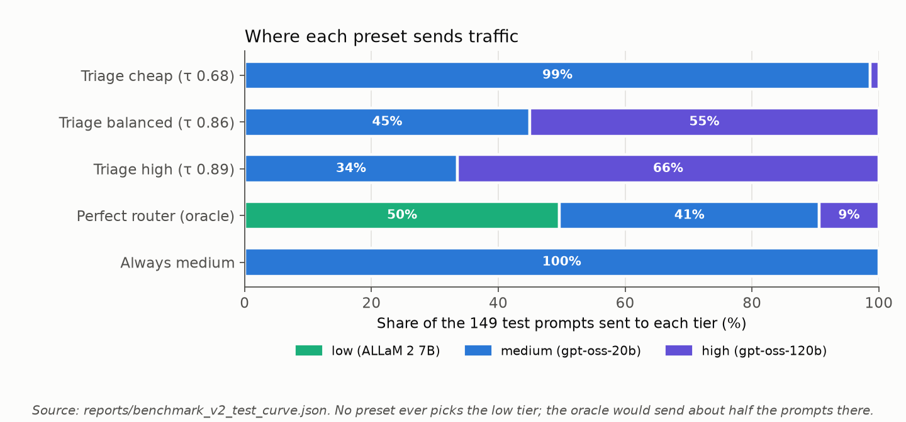

*Share of test prompts sent to each tier: no preset uses the cheap tier, while the perfect router sends half the prompts there.*

**How to read this honestly:**

- **The dial works as designed.** Turning it up buys quality with money in a smooth, predictable way.
- **Triage doesn't beat always using the medium model.** At the medium model's cost, the curve sits at or slightly below it. The cheap preset spends a little more than always-medium for one extra correct answer.
- **The cheap tier is effectively unused at the presets.** The classifier is rarely confident enough that the cheap model will pass, and that model passes only about half the test prompts, so there's little safe room there.
- **The gap to the perfect router is a prediction problem.** Feeding the simulator perfect predictions reproduces the perfect router exactly. The most valuable decision is spotting the roughly 1 in 10 prompts that the medium model fails, and the classifier ranks prompts only modestly better than chance at that (AUC 0.67).
- **With the first classifier,** the same test set gave 99.3% kept / 16% saved on balanced and 93.1% / 57% on cheap, and Triage beat random routing at the same mix by about 3 quality points on average.

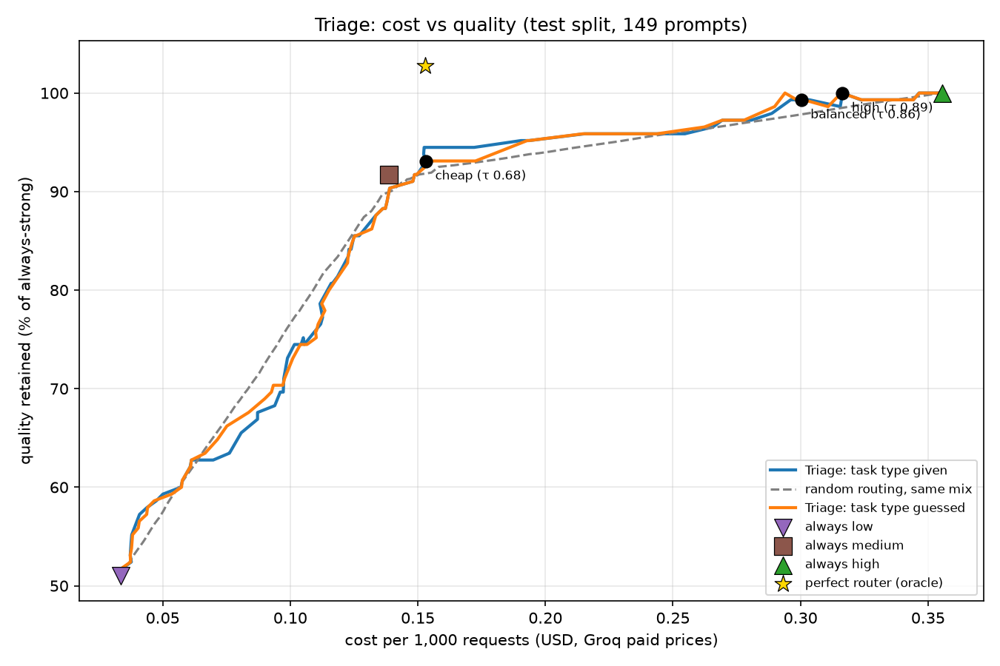

*The first classifier's curve against random routing at the same mix.*

### Can checking answers beat prediction?

Phase 4 tested an alternative: answer with the medium model, have an AI checker judge the answer, and escalate to the strong model only when the check fails. To save money, the check is skipped when the classifier is already confident.

**On validation, it looked promising:** checking matched always-strongest (113 of 117 correct) while saving 27.9%, roughly tied with prediction alone (113 of 117, 28.4% saved).

**The pre-registered test didn't confirm it:**

| Strategy (test set) | Correct | Quality kept | Cost saved |
|---|---|---|---|
| Always medium | 133 | 91.7% | 61.0% |
| Always strongest | 145 | 100.0% | 0% |
| Prediction only (balanced) | 144 | 99.3% | 12.4% |
| Selective checking (pre-registered) | 139 | 95.9% | 29.6% |
| Perfect router | 149 | 102.8% | 57.0% |

- The medium model was wrong on 16 test prompts. A simple format check caught 2, and 2 more were never checked because the classifier was confident. Of the 12 the AI checker saw, it **caught 4 and missed 8**, and it raised 4 false alarms on good answers.
- Random routing at the same cost would get about 139.2 right; selective checking got 139. **The checker added no measurable value,** so prediction-only routing stays the default and checking is opt-in (`X-Triage-Verify: sync`).


*Left: quality vs savings on the test set. Right: cost as the strong model gets pricier, with settings fixed.*

**Why it didn't pay off:** the medium model is already right about 90% of the time, so most checks confirm a good answer; a check costs about three quarters of a medium answer; Groq's strong model costs only twice as much as the medium one, so escalating directly is cheap; and the checker was the same model as the medium tier, checking its own kind of answer.

### Answer-checker calibration

Before choosing a checker, two candidate models were measured on 241 medium answers:

| Checker | Catch rate (95% CI) | False-alarm rate | Consistent on repeat runs |
|---|---|---|---|
| gpt-oss-20b | 52% (40–64%) | 3.2% | 18 of 20 |
| gpt-oss-120b | 56% (43–67%) | 4.5% | 17 of 20 |

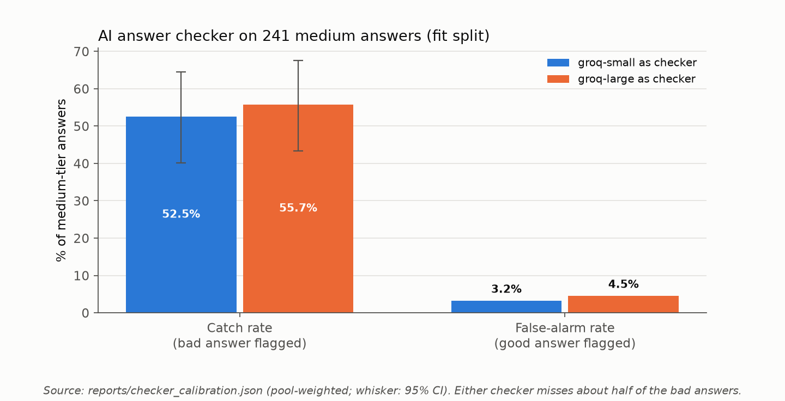

*Both checkers miss about half of the bad answers; their confidence intervals overlap almost completely.*

The smaller model was chosen: on open-ended prompts, where checking actually runs, it caught more bad answers (23 of 36 against 19), raised fewer false alarms, was more consistent, and costs half as much.

### How far to trust the labels

The LLM judge was re-run, unchanged, on 150 math and multiple-choice answers whose correct answer is known.

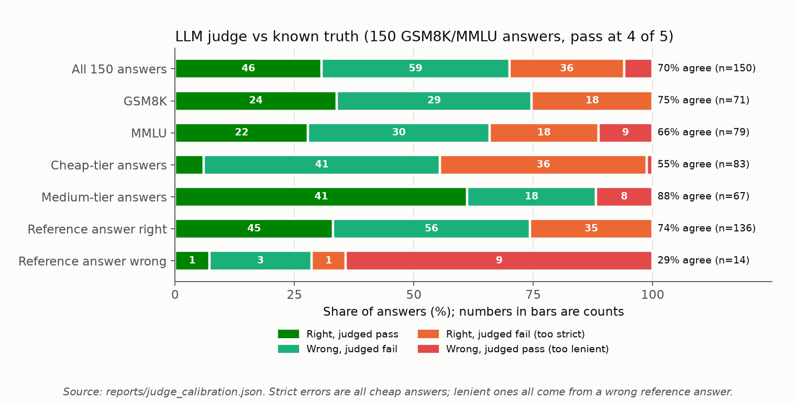

*The judge agrees with the known truth 70% of the time; its errors have two specific causes.*

- **Too strict, in a narrow way.** Every correct answer it failed was a cheap-model answer marked down for breaking one literal formatting rule.
- **Too lenient only when its reference was wrong.** Every wrong answer it passed came from cases where the strong model's reference answer was itself wrong. With a correct reference, it never passed a wrong answer.
- **What that means:** some judge-graded labels may be one tier too high over a formatting slip. The 506 automatically graded labels don't depend on the judge at all.

### Price sensitivity

Groq's strong model costs only twice as much as its medium one. Checking should pay off when escalating is expensive, so the strong model's price was scaled up on the validation set. Cost to reach 113 of 117 correct, as a share of always-strongest at that price:

| Price ratio (strong ÷ medium) | 2× | 3× | 5× | 10× | 20× | 30× |
|---|---|---|---|---|---|---|
| Prediction only | 71.6% | 65.8% | 61.2% | 57.7% | 56.0% | 55.4% |
| Selective checking | 72.1% | 53.8% | 39.1% | 28.1% | 22.7% | 20.8% |

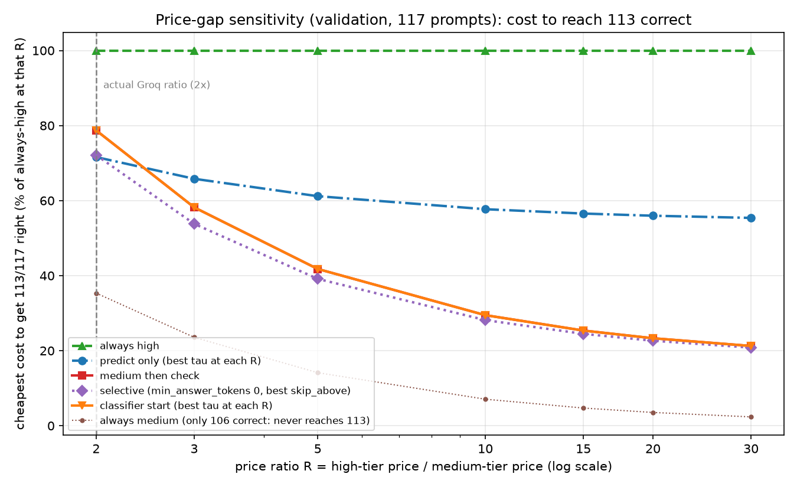

*On validation, checking becomes clearly cheaper once the strong model costs more than about 2–2.5× the medium one.*

On the test set, checking was cheaper at every price ratio but always 5 correct answers behind. Whether checking pays off with real price gaps between providers (for example a small OpenAI model against a frontier Anthropic model) **hasn't been measured yet**.

### Latency


*Answer latency per tier on the training set; the strong model has the slowest tail.*

| Strategy (test set) | Typical (p50) | Slow (p95) |
|---|---|---|
| Always medium | 470 ms | 2,314 ms |
| Always strongest | 665 ms | 5,740 ms |
| Prediction only (balanced) | 516 ms | 5,740 ms |
| Selective checking | 776 ms | 3,757 ms |
| Perfect router | 472 ms | 3,399 ms |

These are free-tier calls made from a laptop, so they compare tiers rather than predict production speed. The routing decision itself adds only 2.2–3.6 ms per request. Production latency **hasn't been measured yet**.

---

## 7. Reliability

LLM providers fail in many ways: rate limits, server errors, "high demand" overloads, slow responses and revoked keys. A large part of the work went into making Triage behave predictably through all of them.

- **One error vocabulary.** Every provider's errors are translated into a few shared kinds (rate limit, server error, overloaded, timeout, bad key and so on), and every decision is made on that kind, never on one provider's specific codes.
- **Retries only where they can help.** Rate limits and server errors are retried a few times with randomised backoff, so many failing requests don't retry in lockstep. A bad key or a bad request is never retried. A slow or overloaded model isn't retried either: the request moves **straight to the next model**.
- **Fallbacks across providers.** Each tier has an ordered list of backup models on other providers, so one provider's outage can't take down a tier. The first model is always the one the classifier was trained on. When users bring their own keys, only their providers are used.
- **Circuit breakers per model.** A model that keeps failing is skipped for a short while, then tried again carefully. Failures are tracked per model, so one slow model doesn't block a whole provider, and one user's bad key never affects anyone else.
- **Timeouts based on measured latency.** Each model's time limit comes from its measured response times, and longer conversations get proportionally more time.
- **A time budget per request.** No request waits longer than a fixed total across all its attempts, so users always get an answer or a clear error in reasonable time.
- **Clear errors.** When every model fails, the error says why ("busy", "too slow", "your key was rejected") and which provider was involved.
- **Escalation only to stronger models.** When an answer is checked and rejected, the replacement must come from a strictly stronger model; a weaker backup never "fixes" a bad answer.
- **Streaming with a Stop button.** Answers stream word by word. Fallback happens only before the first word, so users never see two answers spliced together. When a user presses Stop, Triage tells the provider to stop generating, so nobody pays for words that won't be read, and records an estimated cost for what was produced.
- **A response cache.** Identical repeated requests are answered for free. Users bringing their own keys never share cached answers with anyone.

---

## 8. The product

The research system was then turned into a product that anyone can use.

### Ways to use Triage

| Mode | Who | Whose keys | Limits |
|---|---|---|---|
| Free demo | anyone, no sign-up | Triage's own Groq and Gemini keys | 10 requests per visitor per day, plus a shared daily cap |
| Your own keys | anyone sending their provider keys | the user's, only those providers | 200 requests per visitor per day |
| Account | signed-in users and their API keys | the user's saved, encrypted keys | 60 requests per minute and 10,000 per day |

When the demo runs out, the message suggests adding a provider key, and the website shows the remaining allowance before the first message.

### Accounts

- **Sign-up and log-in** with email and password.
- **Password reset with a 6-digit emailed code**, which expires quickly and stops working after a few wrong tries. The reset never reveals whether an email address has an account.
- **Emails:** reset codes and a welcome email with three setup steps.
- **Saved provider keys** are checked when saved, encrypted, and afterwards shown only by their last 4 characters. If a provider later rejects a key, it's marked as rejected with the reason.
- **Triage API keys** are shown only once, when created. Each app can have its own key, and any key can be revoked at any time.
- **Preferred provider:** users can choose which provider answers first; savings are then measured against that provider's own strongest model.

### Web app

- **Landing page:** the problem, how routing works, an interactive quality-dial demo driven by the real benchmark results, the two-line integration, security, and FAQs.
- **Chat:** answers stream word by word with a Stop button, chats are saved in the browser only, and a **routing panel** under each answer explains in plain language which model answered, why, how close the decision was, the cost and the saving.

  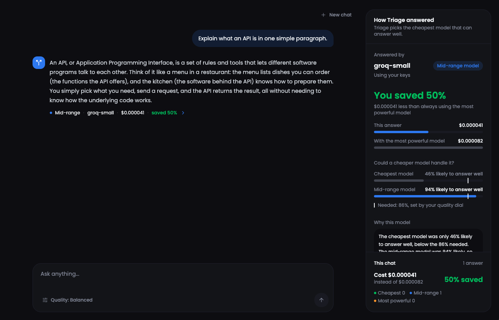

  *A chat answer with its routing panel: which model answered, why, the cost and the saving.*

- **Settings:** a setup checklist, provider keys, Triage API keys, and the account (profile, password, clear chats, delete account).
- **Dashboard:** *Benchmark* (the test results), *Overview* (live totals across all users, shown only once there are enough requests that no individual is identifiable), and *My usage* (spend, savings, a saved percentage per API key, and recent requests).

  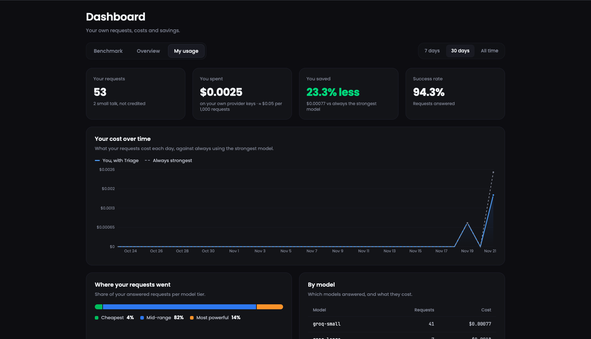

  *My usage from local testing: requests, spend, savings and success rate, daily cost against always using the strongest model, and where requests went.*

  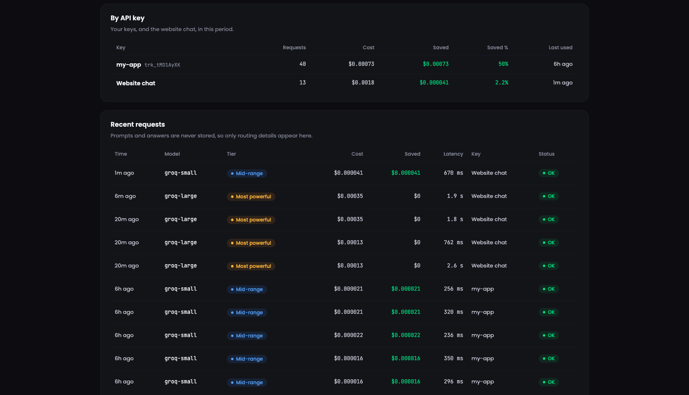

  *Savings per API key and recent requests from local testing, with routing details only: prompts and answers are never stored.*

- **Privacy page,** and a layout that works on phones.

**Not measured yet:** real users, traffic or real-world savings. Triage has only just been deployed, so there is no real usage data yet.

---

## 9. Security and privacy

### Principles

- **Secrets are never stored in readable form.** Passwords, session tokens, Triage API keys and reset codes are stored only as one-way hashes.
- **Provider keys are encrypted** with AES-256-GCM, bound to their owner so a copied key can't be decrypted for anyone else. Encryption keys can be rotated without downtime. After saving, a provider key is only ever shown by its last 4 characters.
- **No prompt or answer text is ever stored.** The usage log keeps only routing details, cost and timing, plus a keyed fingerprint of the prompt that can't be reversed. Chat history stays in the user's browser.
- **User data isn't used for training.** Requests made through the demo, through an account or with a user's own keys are never used to train the routing model.
- **No IP addresses in readable form.** Visitors are counted for limits using a keyed fingerprint of their address, never the address itself.
- **Abuse protection.** Sign-up, log-in, password reset and key changes are all rate-limited, and failed log-ins never reveal whether an account exists.

### Retention

Cached answers are deleted after 24 hours, and usage records after 12 months. Deleting an account removes the user, their sessions, saved keys and API keys immediately; usage records stay for statistics with the link to the account removed.

### Checking the privacy policy against the code

The privacy policy was drafted first and then checked claim by claim against the code before publishing. That check found statements that were wrong or incomplete, which were corrected. A second pass then changed the code where it didn't live up to the policy: for example, the web server's standard access log recorded visitors' IP addresses, contradicting the policy, so it was turned off everywhere and tests now guarantee no IP address reaches the logs.

---

## 10. Lessons from building it

**1. An error's meaning matters more than its status code.**
Requests to one provider kept failing slowly, and Triage retried the same slow model three times before giving up. The cause: the provider enforced *Triage's own* time limit and reported it back as a server error, so it looked like a temporary failure worth retrying. Treating it as "too slow" and moving straight to the next model fixed it. Then I checked every other provider for the same mistake, and found it in several places. *Lesson: when you find a bug, look for its siblings.*

**2. "Stop" has to reach all the way to the provider.**
When a user stopped an answer, the chat stopped displaying it, but the model kept generating in the background, and the cost kept growing without being recorded. Now Stop closes the connection all the way to the provider, and the cost of what was generated is estimated and recorded. *Lesson: cancelling has to be tested end to end, not just in the user interface.*

**3. A promising idea that the test disproved.**
An AI answer checker looked like it could match the strongest model at much lower cost on the validation set. Because the final test was pre-registered, there was no room to adjust after seeing the results, and on the locked test set it did no better than random routing. It shipped as an opt-in feature instead of the default. *Lesson: decide how you'll judge an idea before you see the results.*

**4. Only claim credit for decisions the system made.**
When a developer asked for a specific model, the statistics still counted the difference from the strongest model as a Triage saving, even though Triage hadn't chosen anything. Savings are now credited only to requests that Triage actually routed. *Lesson: honest metrics are part of the product.*

**5. Model quirks show up first in the data.**
The cheapest model is bilingual and sometimes replied to "hello" in Arabic. The dataset had already shown this in 22 answers a month earlier. A one-line instruction to reply in the user's language fixed it. *Lesson: read the actual answers, not just the scores.*

---

## 11. Key decisions and trade-offs

| Decision | Alternatives | Why | Trade-off |
|---|---|---|---|
| Label prompts by **outcome** (cheapest tier that passed) | Human difficulty ratings | Hand guesses matched outcomes only 34% of the time | Three times the data-collection cost; labels tied to specific models |
| **All three tiers on one provider (Groq)** | Mix providers | Free limits large enough to collect everything | Only a 2× price gap, which limits savings |
| **Logistic regression** on features and embeddings | Gradient boosting, embeddings only | Best results at this data size, and explainable | A modest ceiling (AUC 0.67) |
| A **quality dial** with three presets | One fixed threshold | Different apps value cost and quality differently | Presets still tuned for the first classifier |
| **Pre-register** the final test | Report the best validation result | Validation flattered the answer checker; the test didn't confirm it | Publishing a weak result |
| **Prediction-only routing** by default; checking opt-in | Check every answer | Checking matched random routing on the test set | May give up savings where price gaps are larger |
| **Slow or overloaded models fall back immediately** | Retry everything | A slow model rarely recovers within seconds | A brief blip can cost a fallback to a pricier backup |
| **Circuit breakers per model** | Per provider | Providers fail and rate-limit per model | More state to track |
| **No fallback after the first streamed word** | Restart on another model mid-answer | Users would see two answers spliced together | A mid-answer failure ends with an error |
| **Never store prompt text** | Store prompts for debugging and training | Privacy, and a smaller impact if anything leaks | Harder to debug |
| **Encrypt provider keys,** with rotation | Plain storage, or a cloud key service | Strong, standard and rotatable without downtime | Keys must be re-saved if every encryption key is lost |
| **SQLite locally, Postgres in production** | Postgres everywhere | Tests run offline in seconds | Two databases to support |
| **Retrain only if better on validation** | Retrain on a schedule | A new model can never silently make routing worse | Slower to adapt |
| **Greetings skip the classifier** | Let the classifier decide | Greetings don't need a prediction | A phrase list to maintain |

---

## 12. Limitations and future work

### Limitations

- **Savings at the default are modest:** 12.4% at near-full quality, and no preset clearly beats always using the medium model.
- **The presets haven't been re-tuned** for the current classifier.
- **The test set is small:** 149 prompts, where the medium model was wrong only 16 times, so one or two prompts can move a conclusion. It has also been used twice.
- **The benchmark is Groq-only,** with a 2× price gap. OpenAI, Anthropic and Gemini models haven't been benchmarked yet.
- **No real-world data yet.** Triage has only just been deployed, so there are no measurements of real users, traffic or production latency.
- **Some label noise:** each prompt was answered once per tier, and the judge applies formatting rules literally.
- **Thin coverage of developer tasks,** with only 47 coding prompts.
- **Cost estimates:** the cheapest model's paid price is still unannounced, so its cost is estimated.
- **Not built yet:** email verification at sign-up.

### Future work

**Smarter routing**

1. **Route on speed as well as cost:** a "fast" preset that also uses each model's measured latency, for apps where response time matters.
2. **Learn from user feedback:** thumbs up or down on answers, used as extra training labels from real use, not just the benchmark.
3. **Route across providers:** OpenAI, Anthropic and Gemini models as tiers of their own once they're benchmarked, where price gaps are far bigger than Groq's 2× and answer checking may pay off.
4. **Retrain automatically from real traffic,** keeping the rule that a new model replaces the old one only if it does better, with a report of what changed.
5. **Re-tune the presets and build a better answer checker:** presets tuned for the current classifier, and a checker that is a different, stronger model than the one that wrote the answer.
6. **Smarter caching:** answer near-identical questions from the cache by matching their meaning, not just identical requests.

**Product features**

1. **Teams:** shared accounts with several members, shared provider keys and per-member usage.
2. **Routing rules per app:** pin certain task types to a model, or set a different quality bar per API key.
3. **Email verification at sign-up.**

**Platform and operations**

1. **Shared rate limits across servers,** instead of counting per server in memory.
2. **Save routing settings changed at runtime,** so they survive a restart.
3. **Continuous integration** that runs the Python and web tests on every change.
4. **Monitoring:** production latency, error rates, provider failures and real-world savings, with alerts.

---

## 13. Tech stack and testing

| Layer | Technology |
|---|---|
| API | Python, FastAPI |
| Machine learning | scikit-learn, sentence-transformers, NumPy |
| Providers | the official OpenAI, Anthropic and Google SDKs, plus OpenAI-compatible APIs for Groq |
| Data | SQLAlchemy, Alembic, SQLite, Postgres |
| Security | argon2 password hashing, AES-GCM encryption, HMAC fingerprints |
| Web | React, TypeScript, Vite, Tailwind CSS, shadcn/ui, Recharts |
| Hosting | Oracle Cloud (API, in Docker behind Caddy), Vercel (website), Neon (database) and Resend (email) |
| Charts | matplotlib, generated from the evaluation results |

### Testing

| Suite | Result |
|---|---|
| Python unit and integration tests | **2,319 passing** |
| Postgres tests | 30 tests for behaviour specific to Postgres, run separately |
| Web tests | 20 passing |

The test suite runs without any network access: providers are simulated. Some of the more interesting kinds of tests:

- timeouts checked against a **real, deliberately slow local server**;
- every endpoint checked to be callable from a **browser** (cross-origin requests), not just from code;
- streamed answers checked when the network splits them at **awkward points**, such as in the middle of a character;
- the database and logs searched for **leaked keys, prompts or answers**;
- the served model's settings checked to **match the settings it was trained with**;
- **concurrency** tests on Postgres for the usage limits.

There's no continuous-integration setup yet; tests run locally.

---

## 14. Timeline

### Research and planning (September 1 – September 28)

About four weeks of research and planning before the first line of code:

- **How to build an LLM router:** the architecture it needs, and which technologies and languages to use.
- **Provider APIs:** reading the API documentation of OpenAI, Anthropic, Google Gemini and Groq.
- **Machine learning:** studying the concepts the router would need.
- **Existing routing tools:** looking at tools that already route requests between models, and working out what Triage could do differently.
- **Tokens and pricing:** learning how tokens are counted and how each provider prices them, so cost and savings are calculated correctly.

### Phase 1: providers and reliability (September 29 – October 12)

- One consistent way to call every provider, with streaming.
- A reliability layer with retries, fallback chains and circuit breakers.
- A response cache for repeated requests.
- ★ **The provider layer works end to end** (October 12).

### Phase 2: the labelled dataset (October 17 – October 29)

- **October 17–19:** 162 hand-reviewed custom prompts, plus 200 each from GSM8K, MMLU and Chatbot Arena, merged into 762 prompts. Every prompt answered by all three tiers.
- **October 20–23:** automatic scoring, 50 blind hand labels, and an LLM judge for open-ended answers, refined over three versions and then frozen. Outcome labels built and the train/test split locked.
- **October 28–29:** final exclusions, and the hand labels compared with real outcomes. ★ **Dataset complete** (October 29).

### Phase 3: the classifier and evaluation (November 1 – November 7)

- **November 1–2:** handcrafted prompt features and a review of the prompts every tier failed.
- **November 3–7:** embeddings and classifier training, with the approaches compared (November 3). The quality dial (November 4). The routing simulator and baselines: ★ **first working router** (November 5). Judge calibration and ★ **the first locked test** (November 7).

### Phase 4: checking and the API (November 7 – November 11)

- **November 7–8:** a validation split, timeouts based on measured latency, the second classifier, and the AI answer checker.
- **November 9–11:** ★ **the OpenAI-compatible API works**, with streaming (November 9). A usage log that never stores prompt text. The checker chosen by calibration (November 10). Safe retraining that only replaces the model if it does better. ★ **The pre-registered test** (November 11): the checker added no measurable value.

### Phase 5: the product (November 12 – November 20)

- **November 12–15:** bring-your-own-key access for OpenAI and Anthropic models, the public demo with limits, the web app and chat with routing explanations, and Postgres support. ★ **Accounts** (November 15): sign-up and log-in, encrypted provider keys, Triage API keys, and chat with an account's own keys. The landing page.
- **November 16–19:** sign-up and log-in pages, password reset by emailed code, settings pages and a welcome email. Reliability hardening: slow and overloaded providers handled properly, escalation only to stronger models, time budgets, the small-talk rule and the language fix. The privacy policy, checked against the code before publishing.
- **November 20:** ★ **the dashboard**, with Benchmark, Overview and My usage. The privacy policy's promises enforced in code, a layout that works on phones, and ★ **streaming in the web chat, with Stop**.