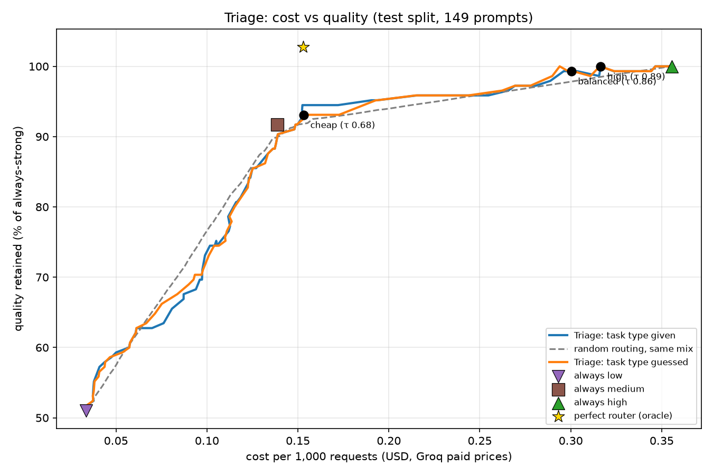

# Phase 3: Classifier, quality dial, and evaluation

## Summary

Phase 3 turned the Phase 2 outcome labels into a working router. For each request, Triage predicts the chance that the cheap and medium tiers will pass, then sends the request to the cheapest tier whose chance clears a quality threshold τ that developers can set per request. Everything was measured against simple baselines, with τ presets chosen on training data only and a single, final run on a locked test set of 149 prompts.

On that test set, the quality dial works as designed: the `balanced` preset keeps 99.3% of always-strong quality while saving 16% of the cost, and the `cheap` preset keeps 93.1% while saving 57%. Triage beats random routing at the same tier mix by about 3 quality points. It does not clearly beat the simplest strong baseline, always using the medium model, which keeps 91.7% while saving 61%. A perfect router would keep 102.8% while saving 57%, so the opportunity is real; the limiting factor is prediction quality, not the routing machinery. Feeding the router perfect predictions reproduces the perfect router exactly.

## What was built

| Piece | File | Purpose |
|---|---|---|
| Handcrafted features | `app/router/features.py` | 14 numbers per prompt: length, reasoning words, constraints, context, output format, task type (8 types) |
| Embeddings | `app/router/embeddings.py` | 384-dim `all-MiniLM-L6-v2` vector; long prompts are chunk-averaged (55 of 762) |
| Classifier training | `eval/train_classifier.py` | One "will this tier pass?" model per lower tier; 5-fold CV on train only; versioned saves |
| Quality dial | `app/router/quality.py` | `choose_tier`: cheapest tier with pass probability ≥ τ; `X-Triage-Quality` header parsing |
| Predictor | `app/router/predictor.py` | Prompt → features + embeddings → classifier → probabilities; refuses to start on version or column mismatches |
| Simulator and baselines | `eval/routing_sim.py`, `eval/baselines.py` | Scores any strategy with real Phase 2 pass/fail, cost and latency, with no API calls |
| Pareto sweep | `eval/pareto.py` | τ from 0 to 1, Triage's cost-quality curve against every baseline; one-time `--final` mode |
| Cascade experiments | `app/verifier/checker.py`, `app/verifier/agreement.py`, `eval/cascade.py`, `eval/agreement_sim.py` | Check-then-escalate strategies, simulated on Phase 2 answers |
| Judge calibration | `eval/judge_calibration_sample.py`, `eval/judge_calibration.py` | The Phase 2 judge re-run on 150 answers with known truth |

Cost is estimated at Groq's published paid prices (`price_as` in `config/models.yaml`); every run was on free tiers.

## Data

Of 762 prompts, 747 are labeled. Fourteen were excluded because the strong model's reference answer was unusable, and one (`arena_0067`) because judging it exceeded the free tier's 8,000-token request limit. Labels are the cheapest tier that passed: 333 low, 329 medium, 85 high. The locked split leaves 598 labeled training prompts and 149 labeled test prompts. A re-review of the 11 prompts that every tier failed found no wrong answer keys and 2 ambiguous MMLU questions; none were excluded (`data/review_decisions.md`).

## Classifier comparison (5-fold cross-validation, train split)

| Classifier | Cheap ROC AUC | Medium ROC AUC | Cheap Brier | Medium Brier |
|---|---|---|---|---|
| Task type only (baseline) | 0.581 | 0.613 | 0.233 | 0.112 |
| A: handcrafted features, tuned | 0.643 | 0.620 | 0.229 | 0.112 |
| B: embeddings, fixed C = 1.0 | 0.569 | 0.612 | 0.389 | 0.167 |
| B: embeddings, tuned | 0.660 | 0.660 | 0.227 | 0.111 |
| **C: both, tuned logistic regression** | **0.672** | **0.667** | **0.224** | **0.111** |
| C: both, gradient boosting | 0.627 | 0.659 | 0.251 | 0.122 |

Untuned embeddings overfit badly (384 dimensions, about 600 examples): a Brier score of 0.389 is worse than a coin flip. Cross-validated regularization (C ≈ 0.003) fixed it. Gradient boosting underperformed plain logistic regression at this data size. B and C tied on the training-set Pareto curve; C was kept because its handcrafted features make decisions easier to explain. The strongest handcrafted signal is the number of constraints in a prompt: more rules make the cheap model more likely to fail.

## Final results (locked test split, 149 prompts, run once)

| Strategy | Quality kept | Cost saved |
|---|---|---|
| Always cheap | 51.0% | 91% |
| Always medium | 91.7% | 61% |
| Always strong | 100% | 0% |
| Perfect router (oracle) | 102.8% | 57% |
| **Triage `cheap` (τ 0.68)** | **93.1%** | **57%** |
| **Triage `balanced` (τ 0.86, default)** | **99.3%** | **16%** |
| **Triage `high` (τ 0.89)** | **100.0%** | **11%** |

Quality kept is pass rate relative to always-strong; it can exceed 100% because a cheaper tier sometimes passes where the strong model fails. The cheapest τ keeping 95% of strong quality was 0.75 (46% saved), and keeping 98% was 0.85 (17% saved). At always-medium's cost or less, Triage's best quality was 89.0%, below always-medium's 91.7%. Averaged over the curve, Triage beat random routing at the same tier mix by 3.0 points with hand-tagged task types and 2.8 points with guessed ones; the 69%-accurate keyword task guesser cost almost nothing overall. Router overhead was 2 to 4 ms per request.

In the chart, Triage's two curves stay close to the grey random-routing line below always-medium's cost and run slightly above it between always-medium and always-strong, where the presets sit. The perfect router (gold star) sits far above every curve. The presets moved from their training-set values (`balanced` was 95% kept and 23% saved on train), which is expected on a 149-prompt test set: differences of one to three points are within noise.

## Why Triage doesn't beat always-medium yet

The most valuable decision a router can make here is spotting the roughly 13% of prompts that medium fails and sending only those to the strong model. On the training set, the perfect router saves less than always-medium (56% versus 63%) because those hard prompts are also the most expensive to answer, yet it gains 12 quality points. The medium-tier classifier ranks prompts only slightly better than chance (AUC 0.67), so raising τ sends prompts to the strong model almost blindly. Running the sweep with perfect probabilities reproduces the oracle exactly (101.0% kept, 56% saved on train), confirming that the gap comes entirely from prediction quality. The live predictor was also checked against the training pipeline and matched it exactly (maximum difference 0.0), ruling out training/serving skew.

Two properties of the setup make the problem harder. The cheap model (ALLaM 2 7B) passes only 43% of training prompts, which leaves little room to use it safely. And medium's failures are concentrated in open-ended prompts (Arena conversations and writing tasks), where neither the prompt nor a quick look at the answer reveals much.

## Cascade experiments (train split)

Two check-then-escalate approaches were simulated on the Phase 2 answers, without API calls.

A **format-only checker** (cut off, empty, wrong script, refusal, invalid JSON, missing `Answer:` line or option letter) was precise but nearly blind: 97% of the cheap answers it flagged were truly bad, but it caught only 21% of cheap failures and 4% of medium failures, because most wrong answers are well-formed. Medium → strong escalation kept 89.8% versus always-medium's 89.3%.

A **two-model agreement check** compares final answers between models. As a signal it is strong: when cheap and medium agree, medium is right 96% of the time, and disagreement catches 77% of medium's failures. As a strategy (`agree low+medium`, 92.1% kept and 46% saved), it performed exactly as well as blindly mixing medium and strong at the same cost. Most disagreements are the cheap model's errors, which triggers unneeded escalations, and the check only applies to the 58% of prompts with a short final answer, where medium rarely fails anyway. Variants using the local llama 3B model were penalized by a pricing error (below).

## Judge calibration

The Phase 2 judge was re-run, unchanged, on 150 training-split GSM8K and MMLU answers whose truth is known from exact match. It agreed with the truth on 70%, passed 9 wrong answers (13% of wrong answers) and failed 36 correct ones (44% of correct answers). Both kinds of disagreement have specific causes. All 36 correct answers it failed were cheap-tier answers capped for breaking one literal format rule, "ends with `Answer: …`", because the cheap model added text after its answer line. All 9 wrong answers it passed came from the 14 cases where the strong model's reference answer was itself wrong and the candidate repeated it. When the reference was correct, the judge never passed a wrong answer. The judge's content judgments are therefore reliable, which matters for the next phase; its weaknesses are literal format enforcement and inheriting a wrong reference. GSM8K and MMLU labels were graded by exact match and are unaffected.

## Limitations

The test set is small (149 prompts), so differences of a few points are uncertain. Costs are estimates at published paid prices; ALLaM 2 7B's price is listed as pending, so its estimate borrows Llama 3.1 8B's last price. The local llama 3B model was priced like gpt-oss-20b during Phase 2, which overstated its cost in the agreement experiments; `models.yaml` is now corrected, but the saved answers keep the old figure. Latency was measured on free-tier calls from a laptop and compares tiers rather than predicting production speed. Each prompt was answered once per tier at temperature 0, so labels carry some sampling noise. Option C assumed medium passes whenever cheap passed (50 training prompts). Coding prompts, the most common real developer request, make up only about 40 of 762, and there is no system design category. All three tier models are on Groq, so a Groq outage would route every request to backups the classifier never saw.

## Decisions

| Decision | Choice | Reason |
|---|---|---|
| Classifier | `classifier_c_logreg_cv` v1 | Tied with B on the train Pareto curve; more explainable |
| `cheap` preset | τ 0.68 | Best train quality at always-medium's cost or less |
| `balanced` preset (default) | τ 0.86 | Cheapest train τ keeping 95% of strong quality |
| `high` preset | τ 0.89 | Cheapest train τ keeping 98% of strong quality |
| `p_medium` | Raised to at least `p_low` | Medium is the stronger model; matches option C |
| Judge pass line | Unchanged (≥ 4) | Changing it would relabel all of Phase 2; revisit next phase |

## Next phase

The clearest path to beating always-medium is an **AI answer checker for open-ended prompts**: let medium answer, have a model judge the answer's content, and escalate only the ones it rejects. Judge calibration suggests this is feasible, since the judge's content judgments were reliable whenever its reference was correct; the checker should separate content from literal format rules, so a trailing sentence doesn't trigger an expensive escalation. Two further directions follow from the findings: testing a model lineup with a stronger cheap tier, where routing has more room to save, and adding coding and open-ended prompts (with two samples per prompt) to strengthen both the classifier and the labels. Small fixes to carry over are broader coding keywords in the task-type guesser and a system design category.